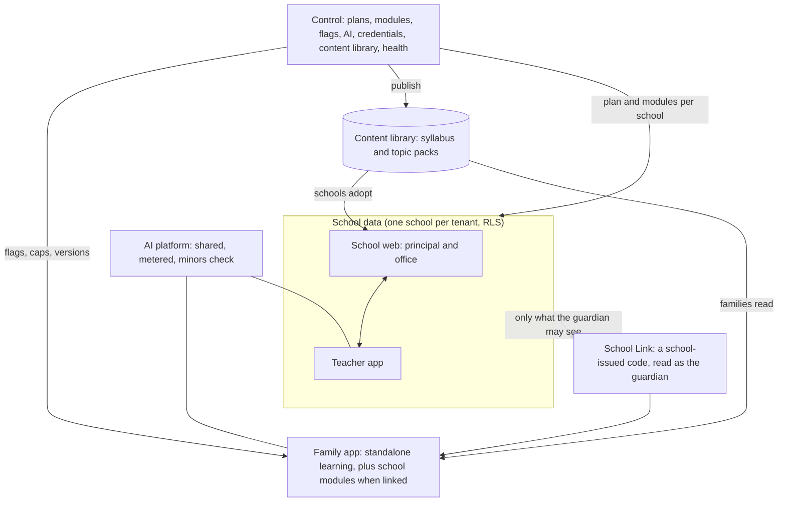

# 34 — One ecosystem: how every app connects, syncs and is run

**Status:** plan (C230-M, revised by C230-N, 2026-10-21). **Asked by the founder:** how Control, the principal and school dashboard, the
Teacher app and the parent and student app connect; what is managed and monitored; how everything stays in sync; and
how the apps reach phones (Android first).

Read with `family-app/10` (Control and the content library) and `family-app/03` §4 (School Link).

## 1. The apps

| App | Where | Who | Works alone? |
|---|---|---|---|
| **Control** | `/control` | NetCyberAI staff | — |
| **School web** (principal and office dashboard) | `/app` | principals, office staff | Needs a school |
| **Teacher app** | the phone shell of `/app` | teachers | Needs a school (a mode for independent tutors is a later decision) |
| **Family app** (parents and students) | `/family`, and the Android app | parents and their children | **Yes.** It works with no school; linking a school adds the school's modules |
| Public website | `/` | everyone | — |

## 2. One backend, one truth

- **There is no copying between apps.** Every app reads and writes the same database through the same API, each with
  its own permissions. A teacher's attendance mark *is* the principal's attendance figure and the linked parent's
  attendance screen at the same moment.
- **Three kinds of data, three owners:**
  - school data (`public.*`): the school's, isolated per school;
  - family data (`family.*`): the family's own learning, never shown to a school unless the family shares it
    (`family-app/05` rule 3);
  - content (`content.*`): NetCyberAI's library, read by all.
- **The only bridge from school to family is School Link.** It reads as the guardian, through the parent rules that
  already exist. Unlinking ends it in the same request.

## 3. How "sync" works

| Mechanism | What it does | Exists today |
|---|---|---|
| Fresh reads | Every screen reads the latest data when opened, on refocus and on pull-down | Yes |
| Background jobs | Side effects (reminders, digests, absence alerts) run from the Postgres job queue | Yes (`src/lib/jobs`) |
| Notifications | Push to the Family app; WhatsApp (through the send-gate) or email to parents without the app; quiet hours and consent respected | Email and WhatsApp yes; push is new (M3) |
| Offline outbox | The Teacher app (and later family practice) queues actions offline, each with its own id, replayed once | Teacher app yes (`src/lib/offline`) |
| Versioned content | Content packs carry a version; a publish makes apps fetch the new one at next open | New (M1) |
| Switches | A Control flag or kill switch changes what every app shows within a minute | New (M1, `family-app/10` §2) |

## 4. Who controls what

Control → school → teacher → family. **Each level can only narrow what the level above allows, never widen it.**

| Level | Decides |
|---|---|
| Control | A school's plan and modules, complimentary modules, AI caps, content versions on offer, every app's flags and kill switches |
| Principal and office | Which of its modules the school uses, staff and classes, the syllabus it adopts, what parents are told |
| Teacher | Class actions: attendance, homework, taught today, marks, Pulse, PTM |
| Family | Whether to link a school, consents, each child's settings, what to share with the school |

## 5. "When a family links a school, the school's modules appear by themselves"

For a linked child, a school module shows in the Family app only when **all four** are true:

1. Control has the module on.
2. The school's plan includes it.
3. The school has switched it on.
4. The guardian link is active.

The app reads this list through School Link: nothing is hard-coded. A school that adds a module later lights it up for
its families with no app update. Unlinking hides every school module in the same request, and the family's own
learning stays.

## 6. The sync matrix (what each action changes, everywhere)

| Action (who) | School web | Teacher app | Family app (linked) | Parents without the app |
|---|---|---|---|---|
| Attendance marked (teacher) | Attendance figures | — | Today and the calendar; a push alert if absent | WhatsApp absence alert |
| Homework set (teacher) | Homework register | Class list | Homework and Tonight's practice | Daily digest |
| "Taught today" (teacher) | Syllabus progress | Logbook; Pulse draft | The Pulse and tonight's talk question | The Pulse on WhatsApp |
| Marks or report card published (school) | Results | Class results | Reports | WhatsApp notice |
| Fee due or paid (office, parent) | Collections | — | Fees and receipts | Reminder with a payment link |
| Notice or event (school) | Notices | Notices | Notices and events | WhatsApp |
| PTM booked (either side) | PTM list | Teacher's slots | Booking; the 14-day plan after | WhatsApp |
| Pulse reply or leave note (parent) | — | The teacher's follow-up queue | Sent | WhatsApp reply, same queue |
| Child practises (family) | **Nothing** unless the family shares | **Nothing** unless shared | Progress, plan, the parent's card | — |
| Content published (Control) | "Update available" for adopted syllabi | Same | New packs at next open | — |
| Module switched off (Control) | Gone within a minute | Gone | Gone | Messages for it stop |

## 7. Services, and how each is watched

| Service | Used for | Health and alert (`family-app/10` §6) |
|---|---|---|
| Vercel (functions in Mumbai) | Every app | Error rate and response time per app; deploy status |
| Supabase (Mumbai) | Database, sign-in, files | `/api/health`, storage health, both databases' fingerprints |
| Resend | Email codes and notices | Test send; bounce rate |
| Meta WhatsApp | Parents without the app (P4) | Send-gate failures; template status |
| AI provider(s) | Copilot, Parent AI, the Family app | Failures, fallbacks, budget at 80% |
| Video search API | Videos in responses (M2) | Daily quota used |
| Razorpay | School fees (P3), Family Plus (M7) | Webhook failures |
| Push (Web Push now, the Android push service later) | Family app alerts (M3) | Delivery failures |
| Google Play | Distributing the Android app | Crash and ANR rates from Play Console |

Credentials for all of these are sealed in Control → Integrations (`family-app/10` §3).

## 8. Android first, the web always, iOS later

**How the Android app is made (revised by C230-N):**
- The Family app is a **native Android shell (Capacitor)** that shows our live web app, plus native modules where the
  web cannot reach: the Focus Lock (§9), and later push and camera.
- It is listed on Google Play as its own app.
- **Why a native shell, not a Trusted Web Activity:**
  - the Focus Lock must live in the same app, because most pilot children use a parent's phone;
  - a Trusted Web Activity runs inside Chrome, and the lock may need to block browsers (YouTube opens in a browser
    too).
- **What updates how:**
  - the screens still load from our deployment, so web fixes and Control switches reach phones at once;
  - only native code (the lock, push) needs a Play release.
- **The Teacher app** gets its own listing later, from the same deployment, when a pilot school needs it.

**Before the Play listing:**
1. A Google Play developer account. An **organisation** account is recommended: it needs a D-U-N-S number, but new
   personal accounts must first run a closed test with at least 12 testers for 14 days (third-party summaries of
   Google's rule; to be confirmed in Play Console).
2. A privacy policy page.
3. The Data safety form.
4. The target audience. It includes children, so Google's Families policy applies: content suitable for children,
   and no advertising SDKs (we have none).
5. Content rating.
6. Play App Signing, with the upload key kept off the repository.
7. For the Focus Lock (§9): the monitoring declaration (`isMonitoringTool` = `child_monitoring`), and the
   permission declarations Play asks for.
8. Tests on budget phones of the brands pilot families use.

**Order on Play:**
- M1: internal test (the founder's phone).
- M2 and M2b: closed test with pilot families, who install from Play by invitation.
- M7: production listing, after the launch gates.

**iOS:**
- The web app works in Safari today.
- An App Store app needs real native value: Apple rejects repackaged websites (guideline 4.2), and the Kids category
  has its own rules.
- The Focus Lock on iPhone needs Apple's Family Controls entitlement, granted on review.
- iOS is planned after the Android evidence, not assumed to be free.

**Scale:**
- 15,000 or more installs fit the current hosting.
- The cost that grows is AI per family. Daily caps and the shared reviewed cache hold it (`family-app/10` §4.3).
- Device variety is handled by the performance budgets (`family-app/09` §4) and a budget-phone test set.

## 9. Focus Lock: learn to unlock (founder, 2026-10-21, C230-N)

**The founder's facts:** most pilot children use a parent's phone, which stays at home. The lock must work on a
shared phone and on a child's own phone.

**Decision:** built as milestone **M2b**, right after M2. M2 delivers what the lock depends on: the daily study plan
and completion that our server has verified.

### 9.1 The rules (the founder's eight, made exact)

| # | Rule | How it works |
|---|---|---|
| 1 | Only the parent sets the PIN | A 6-digit **parent PIN**, set when the family signs up (M1). It also guards the parent area (settings, consents, children, plan, deleting the account), so on a shared phone the child never reaches parent controls. It is stored only as a salted hash. Only the parent can reset it, with a code sent to the parent's email |
| 2 | Apps unlock only when today's study is done | The server says "today's plan is complete" only from checked answers (`family-app/02` §4), never from pages opened. Locked apps then open for the rest of that day's lock window, up to a limit the parent may set. Work done offline counts once it syncs |
| 3, 6 | Blocked with the pending list | Opening a locked app too early shows our screen instead. It lists the chapters, topics and checks still pending, with a button straight to the next one |
| 4 | Calls always work | The phone dialler, contacts, messages and emergency calls are never locked. Android always allows emergency calls. The parent chooses at set-up whether WhatsApp stays open: on a shared phone it is often the family's main calling line |
| 5 | Only entertainment is locked, at set times | The parent picks the apps from the phone's own list, starting from suggestions (social media, games, YouTube, video, browsers), and sets the lock times (for example weekdays 4–9 pm). Our own app, and educational apps the parent marks, stay open |
| 7 | Parent override | The parent PIN opens a parent session. It **re-locks by itself** after a time the parent sets (30 minutes by default) or when the screen turns off, so a phone handed back to the child is locked again |
| 8 | No bypass or guessing | Escalating wait times after 5 wrong PINs; no hints; the PIN is never shown. During lock times, Settings and the Play Store are locked too, so the lock cannot be switched off or uninstalled without the PIN; uninstalling also needs the PIN. **Tamper alerts:** if a permission is revoked, the app is force-stopped, the phone's clock is changed or it starts in safe mode, the parent is told |

### 9.2 What is feasible, and what is not

| Part | Feasible? | How |
|---|---|---|
| Seeing which app is in front, and covering it | Yes | Android's usage-access permission, plus our block screen drawn over the app; both granted by the parent in Settings at set-up, with guided steps |
| Running all day on budget phones | Yes, with set-up steps | A visible "NetCyberAI Focus is on" notification, as Android and Play require. Per brand, a guided step to allow autostart and switch off battery saving for our app, because several budget brands stop background apps |
| Rules 1–7 | Yes | As in §9.1 |
| Rule 8 as "impossible to bypass" | **No** | No ordinary Android app can be made impossible to remove: a determined child can use safe mode or reset the phone. Only a phone set up as a managed device can, and that suits companies, not family phones. **What we promise:** hard to bypass, every bypass detected and reported to the parent, and nothing changeable without the PIN |
| iPhone | Not now | It needs Apple's Family Controls entitlement (§8) |

### 9.3 Privacy, law and store rules

- **On the phone only:** the list of apps, what is opened and when never leave the phone. Our server only knows what
  it already knows ("today's plan is done"). This keeps us away from DPDP section 9's bar on tracking and behavioural
  monitoring of children.
- **Lawyer:** the lawyer confirms the design before the **public** listing (gate L2). The closed pilot may start
  before that, with written consent from pilot parents.
- **Play:**
  - the monitoring declaration (`isMonitoringTool` = `child_monitoring`);
  - a clear disclosure before set-up;
  - the persistent notification;
  - no hidden icon;
  - permission declarations as Play requires.
  No Accessibility API unless usage access proves unreliable; if it is needed, Play's declaration comes first.

### 9.4 Children's sign-in

- **On a shared phone (most pilot families):** the child does not sign in. The parent signs in once. The app opens in
  child mode, with the child switcher; the parent area needs the parent PIN.
- **On a child's own phone (M2b; C230-AF, C346):** the **child's phone** asks for a one-time code and shows it. The
  parent, signed in on their own phone and in the parent area (PIN), types that code and taps the child it is for. The
  child's phone then opens in child mode for that one child; it never opens the parent area.
  - A code alone opens nothing. Only a signed-in parent can approve it, for their own child, at most ten tries an hour.
    Only the phone that asked (by a claim in its own cookie) can take the session, once, within ten minutes.
  - Asking is limited to ten an hour from one network and three hundred in all.
  - The section shows only while Control has the Focus Lock switched on for the family (pilot families); with it off,
    phones already linked are still listed, so the parent can remove them.

## 10. Reviewers (founder, 2026-10-21)

**For now, the founder and the supervisor review.**

- **The supervisor checks before approval:**
  - catalog lines against the official document, in the PR that imports them;
  - numbers recomputed;
  - answer keys re-solved independently;
  - sources and dates.
- **The founder approves in Control.** The importing account can never approve its own draft.
- **Labels say exactly what happened:** "checked by NetCyberAI" means automated checks plus the founder's approval.
  Nothing says "reviewed by a teacher" or "expert reviewed" unless one did. Quality claims never exceed the measured
  pass rate (`family-app/07` §3).
- **Later:** teachers at pilot schools may review topic packs in their own subject from the Teacher app, by choice and
  credited. The ecosystem then supplies reviewers.

## 11. Build order and who builds

1. **One build lead window at a time** on the founder's Mac. A second builder on the same repository collides on
   migrations, Decision Log numbers and shared components (CLAUDE.md "Parallel agents"), as #198 showed.
2. **M1 first** (`family-app/07`). It also builds the platform parts every app needs:
   - Control → AI;
   - Control → Content;
   - Control → Apps v1;
   - the shared AI platform.
   The school web and Teacher app need no change for M1.
3. **Then:** the Android internal test → M2 → M2b Focus Lock (§9) → M3 (the school connected: the sync matrix of §6 becomes visible in the
   Family app, and push arrives) → M4–M7.
4. **Planned school-side features** join the school roadmap (`16`) when the founder lists them. Each is checked
   against §5 and §6 so that it reaches linked families with no extra work.
