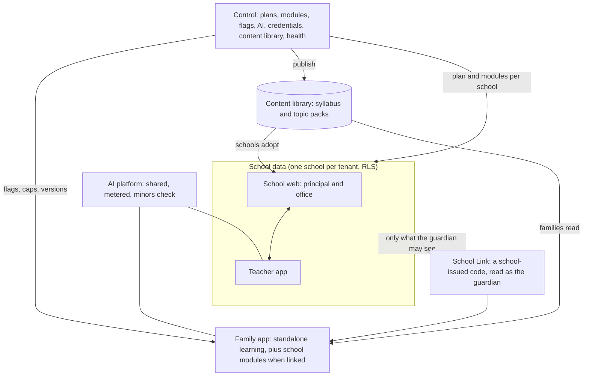

# 34 — One ecosystem: how every app connects, syncs and is run

**Status:** plan (C230-M, 2026-10-21). **Asked by the founder:** how Control, the principal and school dashboard, the
Teacher app and the parent and student app connect; what is managed and monitored; how everything stays in sync; and
how the apps reach phones (Android first).

Read with `family-app/10` (Control and the content library) and `family-app/03` §4 (School Link).

## 1. The apps

| App | Where | Who | Works alone? |
|---|---|---|---|
| **Control** | `/control` | NetCyberAI staff | — |
| **School web** (principal and office dashboard) | `/app` | principals, office staff | Needs a school |
| **Teacher app** | the phone shell of `/app` | teachers | Needs a school (a mode for independent tutors is a later decision) |
| **Family app** (parents and students) | `/family`, and the Android app | parents and their children | **Yes.** It works with no school; linking a school adds the school's modules |
| Public website | `/` | everyone | — |

## 2. One backend, one truth

- **There is no copying between apps.** Every app reads and writes the same database through the same API, each with
  its own permissions. A teacher's attendance mark *is* the principal's attendance figure and the linked parent's
  attendance screen at the same moment.
- **Three kinds of data, three owners:**
  - school data (`public.*`): the school's, isolated per school;
  - family data (`family.*`): the family's own learning, never shown to a school unless the family shares it
    (`family-app/05` rule 3);
  - content (`content.*`): NetCyberAI's library, read by all.
- **The only bridge from school to family is School Link.** It reads as the guardian, through the parent rules that
  already exist. Unlinking ends it in the same request.

## 3. How "sync" works

| Mechanism | What it does | Exists today |
|---|---|---|
| Fresh reads | Every screen reads the latest data when opened, on refocus and on pull-down | Yes |
| Background jobs | Side effects (reminders, digests, absence alerts) run from the Postgres job queue | Yes (`src/lib/jobs`) |
| Notifications | Push to the Family app; WhatsApp (through the send-gate) or email to parents without the app; quiet hours and consent respected | Email and WhatsApp yes; push is new (M3) |
| Offline outbox | The Teacher app (and later family practice) queues actions offline, each with its own id, replayed once | Teacher app yes (`src/lib/offline`) |
| Versioned content | Content packs carry a version; a publish makes apps fetch the new one at next open | New (M1) |
| Switches | A Control flag or kill switch changes what every app shows within a minute | New (M1, `family-app/10` §2) |

## 4. Who controls what

Control → school → teacher → family. **Each level can only narrow what the level above allows, never widen it.**

| Level | Decides |
|---|---|
| Control | A school's plan and modules, complimentary modules, AI caps, content versions on offer, every app's flags and kill switches |
| Principal and office | Which of its modules the school uses, staff and classes, the syllabus it adopts, what parents are told |
| Teacher | Class actions: attendance, homework, taught today, marks, Pulse, PTM |
| Family | Whether to link a school, consents, each child's settings, what to share with the school |

## 5. "When a family links a school, the school's modules appear by themselves"

For a linked child, a school module shows in the Family app only when **all four** are true:

1. Control has the module on.
2. The school's plan includes it.
3. The school has switched it on.
4. The guardian link is active.

The app reads this list through School Link: nothing is hard-coded. A school that adds a module later lights it up for
its families with no app update. Unlinking hides every school module in the same request, and the family's own
learning stays.

## 6. The sync matrix (what each action changes, everywhere)

| Action (who) | School web | Teacher app | Family app (linked) | Parents without the app |
|---|---|---|---|---|
| Attendance marked (teacher) | Attendance figures | — | Today and the calendar; a push alert if absent | WhatsApp absence alert |
| Homework set (teacher) | Homework register | Class list | Homework and Tonight's practice | Daily digest |
| "Taught today" (teacher) | Syllabus progress | Logbook; Pulse draft | The Pulse and tonight's talk question | The Pulse on WhatsApp |
| Marks or report card published (school) | Results | Class results | Reports | WhatsApp notice |
| Fee due or paid (office, parent) | Collections | — | Fees and receipts | Reminder with a payment link |
| Notice or event (school) | Notices | Notices | Notices and events | WhatsApp |
| PTM booked (either side) | PTM list | Teacher's slots | Booking; the 14-day plan after | WhatsApp |
| Pulse reply or leave note (parent) | — | The teacher's follow-up queue | Sent | WhatsApp reply, same queue |
| Child practises (family) | **Nothing** unless the family shares | **Nothing** unless shared | Progress, plan, the parent's card | — |
| Content published (Control) | "Update available" for adopted syllabi | Same | New packs at next open | — |
| Module switched off (Control) | Gone within a minute | Gone | Gone | Messages for it stop |

## 7. Services, and how each is watched

| Service | Used for | Health and alert (`family-app/10` §6) |
|---|---|---|
| Vercel (functions in Mumbai) | Every app | Error rate and response time per app; deploy status |
| Supabase (Mumbai) | Database, sign-in, files | `/api/health`, storage health, both databases' fingerprints |
| Resend | Email codes and notices | Test send; bounce rate |
| Meta WhatsApp | Parents without the app (P4) | Send-gate failures; template status |
| AI provider(s) | Copilot, Parent AI, the Family app | Failures, fallbacks, budget at 80% |
| Video search API | Videos in responses (M2) | Daily quota used |
| Razorpay | School fees (P3), Family Plus (M7) | Webhook failures |
| Push (Web Push now, the Android push service later) | Family app alerts (M3) | Delivery failures |
| Google Play | Distributing the Android app | Crash and ANR rates from Play Console |

Credentials for all of these are sealed in Control → Integrations (`family-app/10` §3).

## 8. Android first, the web always, iOS later

**How the Android app is made:**
- The Family app is packaged as a Trusted Web Activity: an Android app that opens our web app full screen through
  Chrome. It is listed on Google Play as its own app.
- **Why:**
  - one codebase;
  - every fix reaches phones without a store release;
  - Control's switches act at once;
  - the install stays small for budget phones.
- **A native shell** (Capacitor) is used only when a feature truly needs native code (for example §9 step 2). The
  package name and signing key carry over, so the Play listing stays the same.
- **The Teacher app** gets its own listing later, from the same deployment, when a pilot school needs it.

**Before the Play listing:**
1. A Google Play developer account. An **organisation** account is recommended: it needs a D-U-N-S number, but new
   personal accounts must first run a closed test with at least 12 testers for 14 days (third-party summaries of
   Google's rule; to be confirmed in Play Console).
2. A privacy policy page.
3. The Data safety form.
4. The target audience. It includes children, so Google's Families policy applies: content suitable for children,
   and no advertising SDKs (we have none).
5. Content rating.
6. Digital Asset Links on our domain.
7. Play App Signing, with the upload key kept off the repository.
8. Tests on budget phones.

**Order on Play:**
- M1: internal test (the founder's phone).
- M2–M3: closed test with pilot families, who install from Play by invitation.
- M7: production listing, after the launch gates.

**iOS:**
- The web app works in Safari today.
- An App Store app needs real native value: Apple rejects repackaged websites (guideline 4.2), and the Kids category
  has its own rules. It is planned after the Android evidence, not assumed to be free.

**Scale:**
- 15,000 or more installs fit the current hosting.
- The cost that grows is AI per family. Daily caps and the shared reviewed cache hold it (`family-app/10` §4.3).
- Device variety is handled by the performance budgets (`family-app/09` §4) and a budget-phone test set.

## 9. Learn-to-unlock (reopened by the founder, 2026-10-21)

**Decision:** designed now, built in two steps.

**Step 1 (M2, web):**
- the child's daily learning goal;
- a "learning done" signal;
- an "ask for screen time" hand-off to the phone's own parental controls (Google Family Link: app limits and bonus
  time);
- an **unlock-credit contract** in our API, so a native companion can plug in later without redesign.

**Step 2 (a native Android companion that locks other apps) waits for four gates:**
1. A lawyer's opinion. DPDP section 9 bars behavioural monitoring of children, and an app watching which apps a child
   opens is close to it.
2. Google Play's approval of the permissions it needs. The Accessibility API policy was tightened from 28 January
   2026, and parental-control use needs a declaration and review.
3. Pilot evidence that step 1 is not enough.
4. Evidence on how many pilot children have **their own phone**.

**Why not now:**
- **Many families share one phone.** Locking apps would lock the parent's own WhatsApp and UPI.
- **Phone makers' battery savers stop background blockers.** This happens on many budget brands and means a heavy
  support load.
- **Family Link already does app limits for free.** Our value is the learning that earns the time, not the lock.

## 10. Reviewers (founder, 2026-10-21)

**For now, the founder and the supervisor review.**

- **The supervisor checks before approval:**
  - catalog lines against the official document, in the PR that imports them;
  - numbers recomputed;
  - answer keys re-solved independently;
  - sources and dates.
- **The founder approves in Control.** The importing account can never approve its own draft.
- **Labels say exactly what happened:** "checked by NetCyberAI" means automated checks plus the founder's approval.
  Nothing says "reviewed by a teacher" or "expert reviewed" unless one did. Quality claims never exceed the measured
  pass rate (`family-app/07` §3).
- **Later:** teachers at pilot schools may review topic packs in their own subject from the Teacher app, by choice and
  credited. The ecosystem then supplies reviewers.

## 11. Build order and who builds

1. **One build lead window at a time** on the founder's Mac. A second builder on the same repository collides on
   migrations, Decision Log numbers and shared components (CLAUDE.md "Parallel agents"), as #198 showed.
2. **M1 first** (`family-app/07`). It also builds the platform parts every app needs:
   - Control → AI;
   - Control → Content;
   - Control → Apps v1;
   - the shared AI platform.
   The school web and Teacher app need no change for M1.
3. **Then:** the Android internal test → M2 → M3 (the school connected: the sync matrix of §6 becomes visible in the
   Family app, and push arrives) → M4–M7.
4. **Planned school-side features** join the school roadmap (`16`) when the founder lists them. Each is checked
   against §5 and §6 so that it reaches linked families with no extra work.
