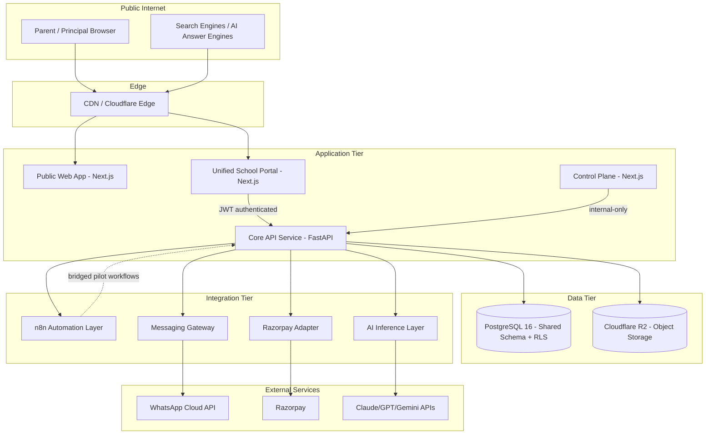
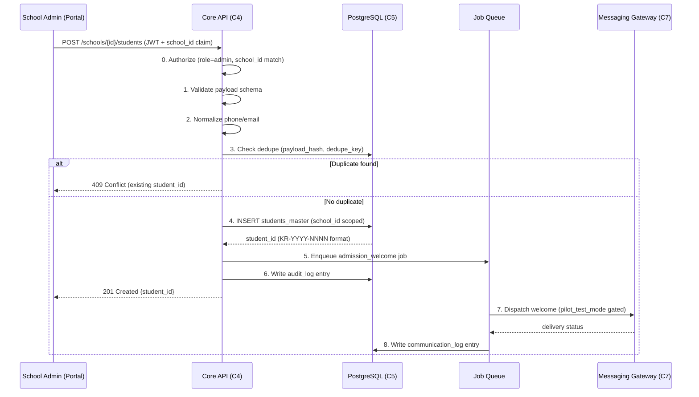
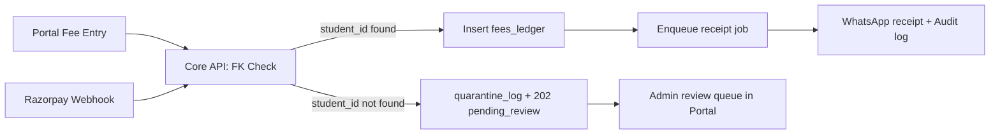
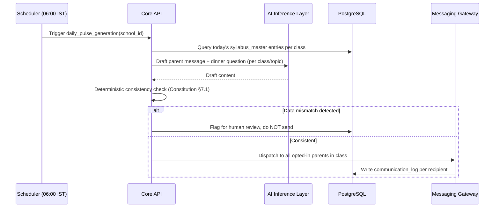
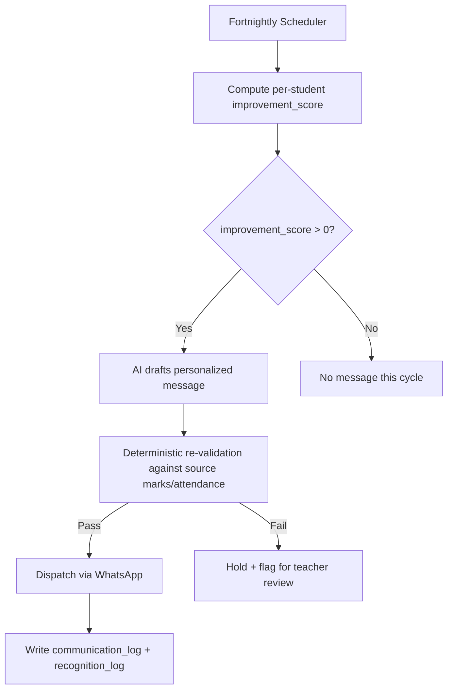
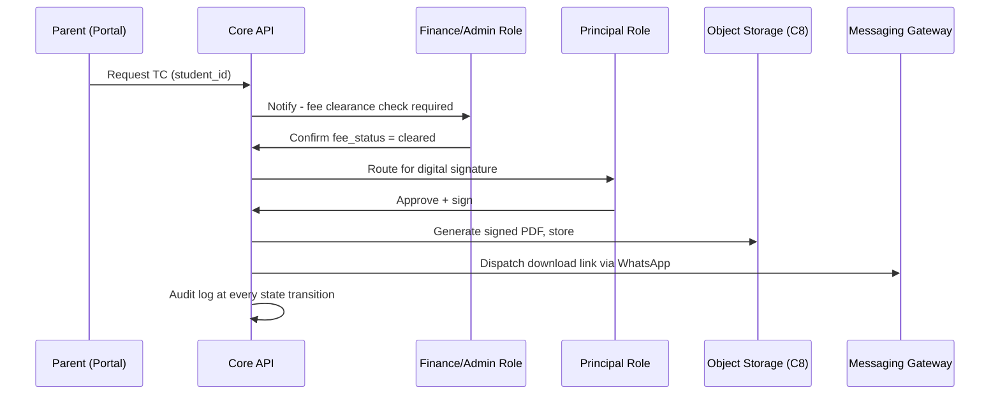
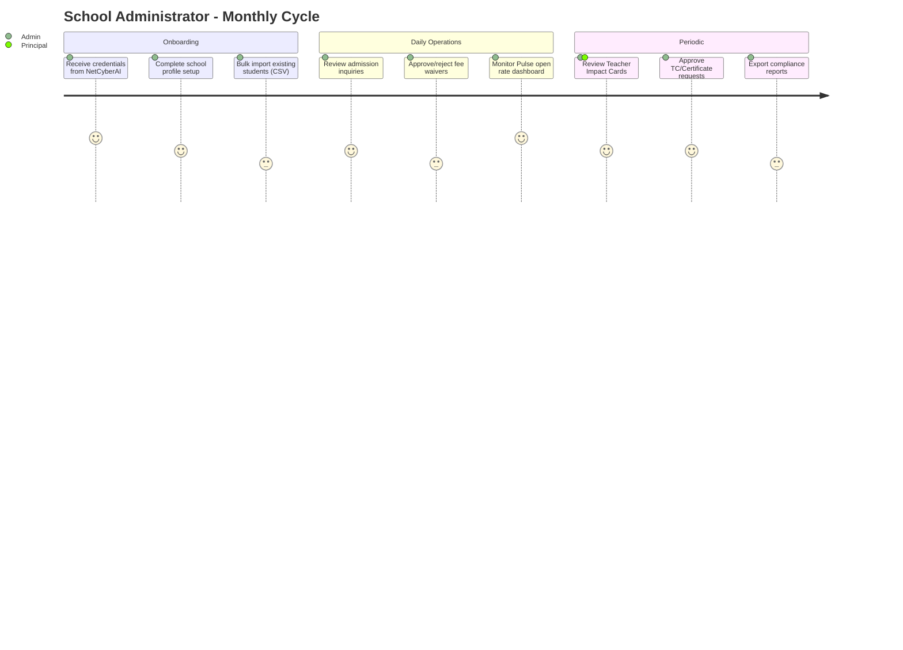

# NETCYBERAI — E2E SYSTEM ARCHITECTURE & WORKFLOW PIPELINE DESIGN

**Document ID:** NCA-ARCH-001
**Version:** 1.0
**Status:** DESIGN SPECIFICATION — Phase 2 Platform (per `docs/VISION/PRODUCT_CONSTITUTION_v1.0.md` §17)
**Audience:** Engineering team implementing the multi-tenant platform
**Related documents:** `PRODUCT_CONSTITUTION_v1.0.md`, `CLAUDE.md` (pilot doctrine), `NCA-AUDIT-002`, `NCA-OPS-003`

---

## 1. Purpose & Scope

This document specifies the complete end-to-end system architecture for the NetCyberAI multi-tenant school platform: all components, data flows, integration points, and workflow pipelines for every core function. It is the engineering source of truth for Phase 2 platform construction and supersedes ad-hoc architectural decisions made during the Phase 1 pilot except where explicitly noted as "inherited from pilot."

**In scope:** system topology, data flow, workflow pipelines, user journeys, dependency graph, scalability targets, cross-module protocols.
**Out of scope:** UI visual design, exact API endpoint signatures (see companion API spec, not yet written), pricing/billing logic detail (see Control Plane doc, `NCA-OPS-003`).

---

## 2. System Components

| # | Component | Responsibility | Technology |
|---|---|---|---|
| C1 | Public Web Application | Marketing site, GEO/SEO content, demo sandbox, lead capture | Next.js (App Router), static + server-rendered |
| C2 | Unified School Portal | Role-scoped dashboard for Principal/Admin/Teacher/Parent/Student | Next.js (App Router), shared codebase with C1 |
| C3 | NetCyberAI Control Plane | Internal tenant management, billing, feature flags | Next.js (App Router), internal-network-gated or IP-allowlisted |
| C4 | Core API Service | Business logic, authorization, orchestration | FastAPI (Python 3.11+) |
| C5 | Canonical Database | System of record for all tenant data | PostgreSQL 16, shared schema, `school_id` + Row-Level Security |
| C6 | Automation/Job Layer | Cross-system sequences, scheduled jobs, legacy pilot workflows | n8n (bridged from pilot per Constitution §14), migrating to C4-native jobs over time |
| C7 | Messaging Gateway | WhatsApp Cloud API, SMS fallback, Email, Telegram (internal ops) | Meta WhatsApp Cloud API, SMTP/SendGrid-class provider, Telegram Bot API |
| C8 | Object Storage | Documents, certificates, uploaded media | Cloudflare R2 (S3-compatible) |
| C9 | Payment Gateway Adapter | Fee collection, webhook-driven ledger updates | Razorpay |
| C10 | Audit & Logging Subsystem | Every mutating action recorded | See `NCA-AUDIT-002` for full spec |
| C11 | AI Inference Layer | Classification, drafting, recognition engine content generation | Claude / GPT-4o-mini / Gemini Flash (tiered per cost, per Constitution §5/§7) |
| C12 | Semantic Search Layer | RAG-based FAQ, future capability | pgvector extension on C5 (readiness only — Constitution §6.3) |
| C13 | Monitoring & Alerting | Health checks, uptime, error rate dashboards | See `NCA-OPS-003` |

---

## 3. High-Level Architecture Diagram

**Diagram notes for implementers:** C2 and C3 never talk to C5 directly — all data access routes through C4 so that authorization, audit logging, and RLS context-setting happen in exactly one place. This is a hard architectural rule, not a suggestion (see §9.2).

---

## 4. Core Workflow Pipelines

Each pipeline below follows the canonical 9-step pattern inherited from the pilot (CLAUDE.md §12.1), generalized with explicit tenant scoping and an authorization check inserted at step 0.

### 4.1 Admission Pipeline

**Success criteria:** P99 latency under 800ms for steps 0-6 (synchronous path); welcome message dispatched within 60 seconds of admission (asynchronous path); zero duplicate `student_id` values per `school_id` (enforced by unique constraint, not just application logic).

### 4.2 Fee Payment Pipeline

Identical shape to 4.1 with these differences: requires FK validation against existing `student_id` before insert (no auto-create); on FK miss, routes to `quarantine_log` and returns `202 Accepted` with a `pending_review` status rather than a hard error (a parent submitting a payment for a not-yet-synced student should not see a scary failure); Razorpay webhook (C9) is an alternate entry point in addition to portal-initiated fee logging, and both converge on the same `fees_ledger` write path.

**Success criteria:** Razorpay webhook to receipt-sent latency under 30 seconds P95. Zero silent-drop fee payments (every payment either lands in `fees_ledger` or `quarantine_log` — never neither).

### 4.3 Daily Learning Pulse Pipeline

**Success criteria:** 100% of dispatched Pulse messages pass the deterministic consistency check before send (§7 of Constitution — non-negotiable). Zero AI-drafted content reaches a parent without this check executing.

### 4.4 Recognition Engine Pipeline (Self-Improvement Tier — Primary)

`improvement_score` formula: see Product Constitution §4.3 — `(new_score - old_score) / (100 - old_score)`, computed per tracked axis (marks, attendance, homework completion).

**Success criteria:** every student with a positive improvement_score on any axis receives exactly one recognition message per fortnight cycle (no duplicates across axes — pick the most significant one per student per cycle to avoid message fatigue).

### 4.5 Recognition Engine Pipeline (Class Top-3 — Secondary, Opt-In)

Same shape as 4.4, gated by a per-school `recognition_class_ranking_enabled` flag in tenant settings (default: **off**, per Constitution §15 Q5, pending Noor's decision — document this default explicitly in the onboarding wizard so principals make an active choice, not an accidental one).

### 4.6 TC / Certificate Pipeline

**Success criteria:** median request-to-delivery time under 2 hours during school operating hours (per Constitution §5 secondary metric). Every state transition (requested → finance-cleared → principal-approved → generated → delivered) is independently audit-logged with timestamp and actor.

### 4.7 At-Risk Student Detection Pipeline

Batch job, runs nightly. Combines attendance trend (rolling 30-day) + marks trend (last 2 assessments) + homework completion rate. Outputs a flagged list to the Teacher Impact Card and triggers a principal-visible alert (never an automated parent-facing message — at-risk flags are a human-in-the-loop signal, per Constitution §7's stakes-based gating).

### 4.8 Teacher Impact Card Computation

Nightly aggregation job. Composite score from: class attendance during their periods, syllabus completion vs. plan, structured parent feedback (rate-limited to prevent complaint-dumping — max 1 feedback submission per parent per teacher per month), at-risk student improvement rate under their instruction. Visible only to the teacher themselves and the principal role (enforced at the RLS + application layer, double-gated per §9.2).

---

## 5. User Journeys

### 5.1 School Administrator Journey

### 5.2 Teacher Journey

Daily: mark attendance (WhatsApp-first path per Constitution §13.1) → receive AI-drafted lesson briefing → submit syllabus completion status. Fortnightly: review own Impact Card, respond to at-risk student flags for their class. As-needed: raise support ticket to principal, submit marks for assessments (triggers report card + recognition engine pipelines downstream).

### 5.3 Parent Journey

Daily: receive Learning Pulse via WhatsApp (no login required — this is the critical zero-friction touchpoint per Constitution §3). As-needed: log into Portal to view fee status, download TC/receipts, respond to teacher feedback requests. Fortnightly: receive recognition message if child shows improvement.

### 5.4 NetCyberAI Central Team Journey

Onboarding: run School Onboarding Wizard in Control Plane (C3) → assign service plan → generate initial admin credentials → seed pilot_test_mode whitelist for staged rollout (inherited discipline from pilot, Constitution §14). Ongoing: monitor global health dashboard, review support escalations, manage feature flags per tenant.

---

## 6. Dependency Mapping

| Component | Depends on | Failure mode if dependency down | Mitigation |
|---|---|---|---|
| C2 (Portal) | C4 (Core API) | Portal shows degraded/read-only mode | Client-side caching of last-known state; clear "system busy" messaging, never a blank screen |
| C4 (Core API) | C5 (Postgres) | All writes fail | Connection pool with circuit breaker; health check gates traffic routing |
| C4 | C7 (Messaging Gateway) | Messages queue but don't send | Retry with exponential backoff (inherited from pilot's `processing_queue` pattern, CLAUDE.md §12.2); dead-letter after max attempts + admin alert |
| C7 | WhatsApp Cloud API (external) | No WhatsApp delivery | SMS/Email fallback per Constitution §11 |
| C9 (Razorpay Adapter) | Razorpay (external) | Payment webhook not received | Reconciliation job runs hourly, cross-checks Razorpay API against local ledger for drift |
| C11 (AI Inference) | LLM provider APIs | AI drafting unavailable | Non-AI fallback templates for time-sensitive messages (fee reminders, receipts) that don't require AI drafting to function |
| C6 (n8n bridge) | C4 (Core API) | Legacy pilot workflows can't reach new data model | Bridge adapter layer maintained until full cutover per Constitution §14 |

---

## 7. Scalability Requirements

| Dimension | Target (Phase 2 launch) | Target (Phase 4, 10+ tenants) | Design implication |
|---|---|---|---|
| Concurrent tenants | 5-10 | 50+ | Shared-schema + RLS (Constitution §6.1); avoid schema-per-tenant until this ceiling is approached |
| Students per tenant | up to 2,000 | up to 5,000 | Indexed `school_id` + `student_id` composite keys on all hot-path tables |
| API request throughput | 50 req/s sustained | 500 req/s sustained | Stateless FastAPI workers behind a load balancer; horizontal scaling, not vertical |
| Messaging throughput | 80 WhatsApp msgs/sec (Meta's documented cap) | Same — cap is provider-side | Queue-based dispatch with rate-limiting middleware honoring the 80/sec ceiling regardless of tenant count |
| Database read load | Single primary sufficient | Read replica for reporting/analytics queries | Defer read replica until reporting query latency measurably degrades primary write performance |
| Object storage | Low GB scale | Low TB scale | Cloudflare R2 scales natively; no redesign needed |

**Explicit non-target:** this architecture is not designed for thousands of tenants or millions of students in Phase 2-4. Re-architect (sharding, schema-per-tenant, dedicated read replicas per region) only when actual growth data demands it — building for hypothetical scale now violates CLAUDE.md's own anti-over-engineering doctrine (§3).

---

## 8. Cross-Module Communication Protocols

1. **Internal service-to-service calls** (C2/C3 → C4): synchronous REST over HTTPS, JWT bearer auth, `school_id` claim embedded and cross-checked against RLS policy on every query — never trusted from the client alone.
2. **Asynchronous job dispatch** (C4 → C6/C7): via the `processing_queue` table pattern inherited from the pilot (CLAUDE.md §12.2) — atomic claim with `SELECT FOR UPDATE SKIP LOCKED`, not a message broker, until queue volume genuinely exceeds what Postgres can handle (unlikely before Phase 4).
3. **External webhook ingress** (Razorpay, WhatsApp delivery receipts): all external webhooks verified via provider-specific signature schemes (Razorpay HMAC, Meta's webhook verification token) before any processing — same HMAC-verification discipline as the pilot's Apps Script webhooks (CLAUDE.md §13, `.claude/skills/hmac-verification/SKILL.md`).
4. **Idempotency:** every mutating endpoint accepts an idempotency key; retried requests with the same key return the original result rather than creating duplicate records. This generalizes the pilot's `payload_hash` dedupe pattern (CLAUDE.md §12.3) to the API layer.

---

## 9. Additional Requirements & Gap Analysis

Gaps identified beyond the original request scope, necessary for a complete design:

### 9.1 API Versioning
All Core API endpoints versioned from day one (`/v1/...`). Breaking changes require a new version path, not in-place modification, because the Public Web App, Unified Portal, and any future mobile client will be independently deployed and cannot be forced to upgrade simultaneously.

### 9.2 Single Data-Access Chokepoint (hard rule)
No component other than C4 (Core API) may query C5 (Postgres) directly. This is stated as a rule, not a preference, because it's the only way to guarantee audit logging (`NCA-AUDIT-002`) and RLS context-setting happen consistently. Any future component (mobile app, third-party integration) must also route through C4.

### 9.3 Rate Limiting Per Tenant
Per-`school_id` rate limits on the Core API (not just global limits) prevent one tenant's misbehaving integration or bulk operation from degrading service for all others — a direct architectural lesson from the pilot's own documented "Multi-Tenancy Trap" failure mode (original technical blueprint, Phase 1 research).

### 9.4 Session & Token Management
JWT access tokens short-lived (15 minutes); refresh tokens longer-lived, stored httpOnly, rotated on use, revocable server-side (a revocation list or short-lived-refresh-with-rotation, not indefinite trust). Parent OTP/magic-link sessions extended-duration (parents will not re-authenticate daily) but individually revocable per Constitution §8's auth design.

### 9.5 File Upload Safety
Any user-uploaded file (teacher document, parent-submitted attachment) passes through virus/malware scanning before being persisted to C8, and content-type validated server-side (never trust client-reported MIME type).

### 9.6 Health Checks & Synthetic Monitoring
Each component exposes a `/health` endpoint checked every 30 seconds by C13. Synthetic transaction monitoring (a scripted fake admission + fee payment, run hourly against a designated test tenant) validates the full pipeline end-to-end, not just component-level liveness.

---

## 10. Success Criteria Summary

| Component/Pipeline | Success Criteria |
|---|---|
| Overall API availability | 99.5% monthly uptime (matches CLAUDE.md's own SLA stance for the pilot — do not over-promise 99.9% at this stage) |
| Admission pipeline | P99 < 800ms synchronous path; welcome message within 60s |
| Fee payment pipeline | Zero silent drops; Razorpay webhook-to-receipt < 30s P95 |
| Daily Pulse | 100% pass deterministic consistency check before send |
| Recognition engine | Zero duplicate messages per student per cycle |
| TC pipeline | Median < 2 hours request-to-delivery |
| Cross-tenant isolation | Zero cross-`school_id` data leakage, verified by automated RLS policy tests in CI |
| Rate limiting | No single tenant able to consume more than its allocated share of shared infrastructure capacity |

---

*End of NCA-ARCH-001. See `NCA-AUDIT-002` for audit trail and logging design; `NCA-OPS-003` for centralized management and disaster recovery design.*
