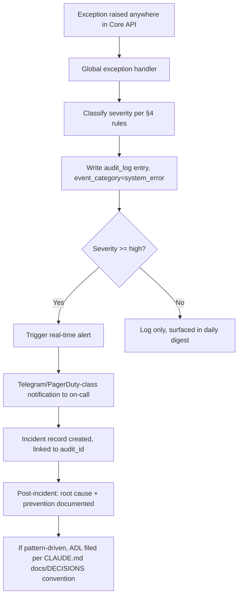
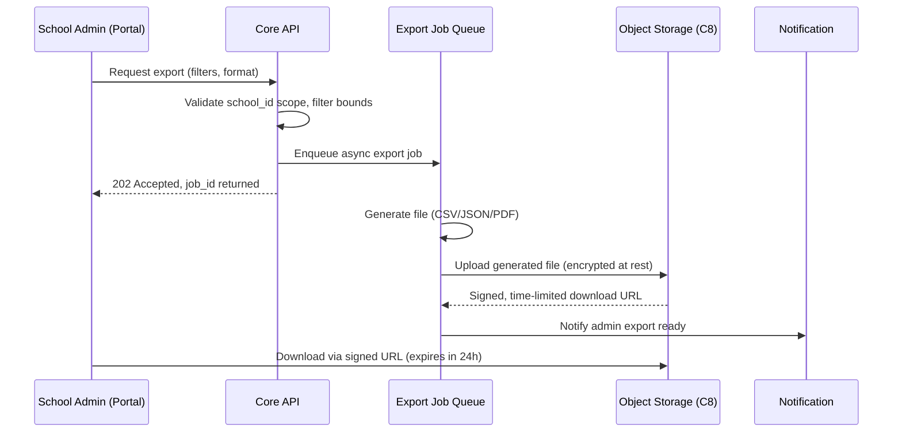

# NETCYBERAI — AUDIT TRAIL, ACTIVITY LOGGING & FILTERING SYSTEM DESIGN

**Document ID:** NCA-AUDIT-002
**Version:** 1.0
**Status:** DESIGN SPECIFICATION — Phase 2 Platform (per `docs/VISION/PRODUCT_CONSTITUTION_v1.0.md` §17)
**Audience:** Engineering team implementing the multi-tenant platform
**Related documents:** `NCA-ARCH-001` (system architecture), `NCA-OPS-003` (centralized management & DR), `PRODUCT_CONSTITUTION_v1.0.md` §7 (AI Governance)

---

## 1. Purpose & Scope

This document specifies the complete audit trail and activity logging infrastructure for the NetCyberAI platform: what gets logged, how severity is classified, how logs are filtered and exported, retention policy, and access control. This system is the forensic backbone that makes the platform's AI governance rails (Constitution §7) enforceable and auditable, and is the mechanism by which any dispute ("the school said my child was doing well") can be reconstructed with certainty.

**Design principle carried forward from the pilot (CLAUDE.md §9, §11):** the goal is not zero incidents — it is zero *silent* incidents. Every mutating action, every AI-generated message, every permission change, and every failure must produce a durable, queryable record.

---

## 2. Audit Event Taxonomy

Every event logged falls into exactly one of these categories:

| Category | Examples | Logged by |
|---|---|---|
| **Authentication** | Login success/failure, password reset, OTP request, session revocation | Core API auth middleware |
| **Authorization** | Permission denied, role change, cross-tenant access attempt (should be impossible — logging catches any RLS bypass attempt) | Core API RLS/RBAC layer |
| **Data mutation** | Student created/updated, fee recorded, attendance marked, marks entered | Core API, at the point of every INSERT/UPDATE/DELETE |
| **Communication dispatch** | WhatsApp/SMS/Email sent, delivery status, failure reason | Messaging Gateway (C7) |
| **AI content generation** | Every AI-drafted message, the prompt version used, the data snapshot referenced, the consistency-check result (pass/fail), human review outcome if applicable | AI Inference Layer (C11), per Constitution §7.3 |
| **Administrative action** | Tenant onboarded, feature flag toggled, service plan changed, user impersonation (support access) | Control Plane (C3) |
| **System/Error** | Unhandled exceptions, failed jobs, dead-lettered queue items, external API failures | Core API, Job Layer, Messaging Gateway |
| **Data export** | Every log export request, by whom, what filter was applied, what format | Audit subsystem itself (self-referential logging — see §6.4) |

---

## 3. Audit Log Schema

```sql
CREATE TABLE IF NOT EXISTS audit_log (
    audit_id            BIGSERIAL PRIMARY KEY,
    occurred_at          TIMESTAMPTZ NOT NULL DEFAULT NOW(),
    school_id            BIGINT REFERENCES schools(school_id),  -- NULL for platform-level events
    actor_user_id        BIGINT REFERENCES users(user_id),      -- NULL for system-initiated events
    actor_role           TEXT NOT NULL CHECK (actor_role IN (
                            'netcyberai_admin','school_admin','principal',
                            'teacher','parent','student','system')),
    event_category       TEXT NOT NULL CHECK (event_category IN (
                            'authentication','authorization','data_mutation',
                            'communication','ai_generation','administrative',
                            'system_error','data_export')),
    event_action         TEXT NOT NULL,       -- e.g. 'student.create', 'fee.update', 'whatsapp.send'
    target_entity_type   TEXT,                 -- e.g. 'student', 'fee', 'user'
    target_entity_id     TEXT,                 -- the affected record's ID
    severity             TEXT NOT NULL CHECK (severity IN ('critical','high','medium','low')),
    outcome               TEXT NOT NULL CHECK (outcome IN ('success','failure','partial')),
    request_id           TEXT,                 -- correlates to a single API request/trace
    ip_address           INET,
    user_agent           TEXT,
    before_state         JSONB,                -- prior record state, for mutations (nullable)
    after_state          JSONB,                -- new record state, for mutations (nullable)
    error_detail         JSONB,                -- structured error info for system_error events
    ai_prompt_version    TEXT,                 -- populated only for ai_generation events
    ai_data_snapshot_ref TEXT,                 -- pointer to the data state the AI drafted against
    metadata             JSONB                 -- category-specific extra fields
);

CREATE INDEX idx_audit_school_time ON audit_log (school_id, occurred_at DESC);
CREATE INDEX idx_audit_actor ON audit_log (actor_user_id, occurred_at DESC);
CREATE INDEX idx_audit_severity ON audit_log (severity, occurred_at DESC)
    WHERE severity IN ('critical','high');
CREATE INDEX idx_audit_category ON audit_log (event_category, occurred_at DESC);
CREATE INDEX idx_audit_target ON audit_log (target_entity_type, target_entity_id);
```

**Design notes:**
- `before_state`/`after_state` captured as JSONB diffs, not full-table snapshots, to keep storage bounded.
- This table is intentionally append-only. No `UPDATE` or `DELETE` statements are permitted against `audit_log` by any application role — enforced by revoking those grants at the database level, not just by convention.
- Partitioning by month (native Postgres declarative partitioning on `occurred_at`) is recommended once table size exceeds ~50M rows, to keep index maintenance and retention-driven deletes performant.

---

## 4. Severity Classification Framework

| Severity | Definition | Examples | Response SLA |
|---|---|---|---|
| **Critical** | Data loss, security breach, cross-tenant data leak, complete messaging outage, AI content sent that failed consistency check | Unauthorized cross-`school_id` query succeeded; Postgres primary unreachable; a factually-wrong AI message reached a parent | Immediate admin Telegram/PagerDuty-class alert; incident response begins within 15 minutes |
| **High** | Single-tenant significant impact, or message dispatch broken for >30 minutes | WhatsApp Cloud API token expired, blocking all sends for one school; fee reminder job failed for an entire class | Alert within 5 minutes; response within 1 hour |
| **Medium** | Degraded operation, no data loss, workaround exists | One Pulse message failed to send to a single parent (delivery retry succeeds); n8n bridge job queue backlog growing but not yet breaching SLA | Logged, reviewed in next daily ops check; no immediate page |
| **Low** | Cosmetic, expected/handled exceptions, dev-environment-only | A well-formed validation rejection (parent typo'd a phone number); local dev cert warning | Logged only, no alert, reviewed only if pattern emerges |

This table is a direct generalization of the pilot's severity guide (`docs/INCIDENT_LOG.md` severity table, established in Session 01) to platform scale — the categories and their meaning are unchanged; only the response tooling (PagerDuty-class alerting vs. solo-operator Telegram) scales up.

---

## 5. Error & Incident Logging Pipeline



This pipeline directly extends the pilot's error-handler pattern (CLAUDE.md §12.2 retry/dead-letter logic, and the `docs/INCIDENT_LOG.md` template established in Session 01) — same philosophy, more automated triggering at platform scale.

---

## 6. Multi-Dimensional Filtering System

### 6.1 Filter Dimensions

School Admins (and, within their scope, Principals) can filter the audit log along any combination of:

| Filter dimension | Values | Notes |
|---|---|---|
| Date range | Any start/end, max 12 months per query (see §7 retention) | Required on every query — no unbounded scans |
| Role | `teacher`, `parent`, `student`, `admin`, `principal` | Maps to `actor_role` |
| Specific user | Any user within their own school | Maps to `actor_user_id`, cross-checked against `school_id` scope |
| Event category | Any of the 8 taxonomy categories in §2 | Maps to `event_category` |
| Severity | critical/high/medium/low, single or multiple | Maps to `severity` |
| Target entity type | student, fee, attendance, communication, etc. | Maps to `target_entity_type` |
| Outcome | success/failure/partial | Maps to `outcome` |

### 6.2 Access Scoping (Critical Design Constraint)

A School Admin or Principal **can only ever query audit events where `school_id` matches their own tenant.** This is enforced identically to every other data access in the platform — via Row-Level Security at the database layer, not solely at the application layer (per `NCA-ARCH-001` §9.2's single-chokepoint rule). A School Admin cannot filter, view, or export another school's logs under any filter combination — this is tested explicitly in the CI test suite (see `NCA-ARCH-001` §10 success criteria).

NetCyberAI Central Team roles (`netcyberai_admin`) can filter across all schools, but every cross-tenant query they run is itself logged as an `administrative` category event with elevated visibility (self-referential audit — an admin viewing School A's logs is itself logged and visible to School A's own admin on request).

### 6.3 Downloadable Filtered Export

School-level administrators can generate an export of filtered results for their own school covering teachers, parents, and all other platform users within that school — per the explicit requirement.

**Export flow:**



**Why asynchronous, not synchronous:** large date-range exports across many users can produce substantial row counts; generating them inline would risk request timeouts and degrade API responsiveness for other tenants. This mirrors the pilot's own backup-script philosophy (CLAUDE.md §19 — backups are a deliberate, tracked operation, not an inline side effect).

### 6.4 Export Formats

| Format | Use case | Structure |
|---|---|---|
| **CSV** | Spreadsheet analysis, compliance submission | Flat structure; JSONB columns (`before_state`, `after_state`, `metadata`) serialized as escaped JSON strings within cells |
| **JSON** | Programmatic re-ingestion, integration with external tools | Full nested structure preserved, one JSON object per line (JSONL) for streaming-friendly large exports |
| **PDF** | Human-readable audit report, board/compliance presentation | Formatted report with school branding, summary statistics header (total events, breakdown by severity/category), followed by tabular detail; generated via a templating engine, not manual formatting |

Every export itself generates a `data_export` category audit log entry (§2), recording who exported what filter set, in what format, when — so export activity is itself auditable, closing the loop the requirement specifically calls for.

---

## 7. Log Retention Policy

| Data category | Retention period | Rationale |
|---|---|---|
| Critical/High severity events | 3 years | Compliance and dispute-resolution window; aligns with typical Indian civil claim limitation periods |
| Medium/Low severity events | 1 year | Operational review window; older low-severity noise has diminishing forensic value |
| Authentication events | 1 year | Security review window |
| AI-generation events (all severities) | 3 years, regardless of severity | Constitution §7.3 requires forensic reconstruction capability for AI-driven disputes — cannot be short-retained even if classified low/medium severity |
| Communication dispatch logs | 1 year (mirrors pilot's existing `communication_log` retention intent, CLAUDE.md decision #17-adjacent) | |

**Enforcement mechanism:** a scheduled job (nightly) moves expired rows to a cold-storage export (compressed, written to object storage) before deleting from the live `audit_log` table, rather than a hard delete with no trace — this satisfies data-minimization principles under DPDP while preserving a recoverable archive for the rare post-retention compliance request.

**Tenant-initiated deletion requests** (a school leaving the platform, or a data-subject erasure request under DPDP) are handled as a distinct, explicitly-authorized workflow — never as a side effect of routine retention cleanup — and are themselves logged before execution.

---

## 8. Access Control Matrix for Log Data

| Role | Can view own actions | Can view others' actions (own school) | Can view other schools | Can export |
|---|---|---|---|---|
| Parent | Own actions only | No | No | No |
| Student | Own actions only | No | No | No |
| Teacher | Own actions | Actions affecting their own classes only (e.g., attendance they marked) | No | No |
| Principal | Yes | Yes, full school scope | No | Yes, full school scope |
| School Admin | Yes | Yes, full school scope | No | Yes, full school scope |
| NetCyberAI Admin | Yes | Yes, all schools | Yes | Yes, all schools (self-logged per §6.2) |

This matrix is enforced at the RLS policy layer, with application-layer checks as defense-in-depth — consistent with the "never rely on application code alone" principle established in `NCA-ARCH-001` §6.1.

---

## 9. Additional Requirements & Gap Analysis

### 9.1 Log Tampering Detection
Because `audit_log` is append-only with no update/delete grants, a periodic integrity job computes a rolling hash chain (each new batch of rows hashed together with the previous batch's hash) to detect any out-of-band tampering (e.g., a compromised superuser directly modifying the database). This is a low-cost addition that materially strengthens the audit trail's evidentiary value.

### 9.2 Real-Time Log Streaming (future capability, not Phase 2 requirement)
For schools at larger scale, a future capability could stream critical/high severity events to an external SIEM tool. Not required now — documented here so the schema (§3) doesn't need retrofitting later; the `event_category`/`severity` structure already supports this without modification.

### 9.3 Search Performance at Scale
Full-text search across `before_state`/`after_state`/`metadata` JSONB fields should use a GIN index once query patterns justify it — not built by default, since premature indexing adds write overhead without a demonstrated read need (consistent with `NCA-ARCH-001` §7's anti-premature-optimization stance).

### 9.4 Parent/Student Self-Service Visibility
Parents should be able to view a simplified, non-technical version of the audit trail concerning their own child (e.g., "who viewed your child's report card, and when") as a trust-building transparency feature — this is a genuinely new capability beyond the original requirement, directly supporting the Constitution's trust-gap mission (§1). Implementation: a filtered, plain-language view of `audit_log` scoped to `target_entity_id = their child's student_id`, excluding internal system fields.

---

## 10. Success Criteria Summary

| Component | Success Criteria |
|---|---|
| Audit coverage | 100% of mutating API calls produce exactly one audit_log entry; verified by CI test asserting audit-log-write occurs in the same transaction as the business mutation (never a separate, droppable step) |
| Severity classification | Every system_error event auto-classified per §4 rules with zero manual triage required for routing to the correct alert channel |
| Filtering scope enforcement | Zero cross-`school_id` query results possible under any filter combination, verified by automated penetration-style tests |
| Export completeness | Every export, regardless of format, contains 100% of records matching the filter — no silent truncation |
| Export audit closure | 100% of export operations themselves produce a `data_export` audit_log entry |
| Retention compliance | Nightly retention job runs with zero manual intervention; cold-storage archive recoverable within 24 hours of a compliance request |
| Tamper detection | Hash-chain integrity check runs daily; any break in the chain triggers a critical-severity alert |

---

*End of NCA-AUDIT-002. See `NCA-ARCH-001` for system architecture; `NCA-OPS-003` for centralized management and disaster recovery design.*
