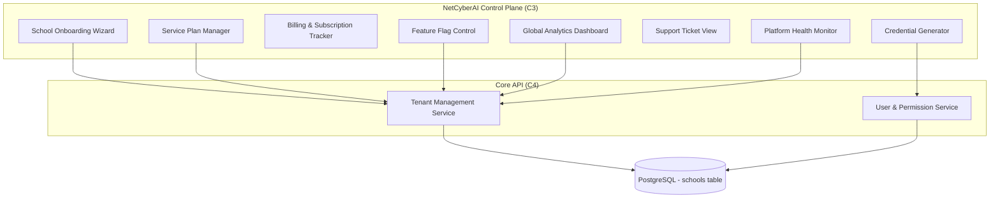
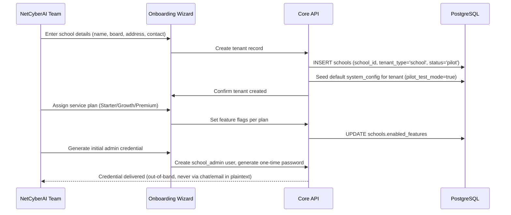
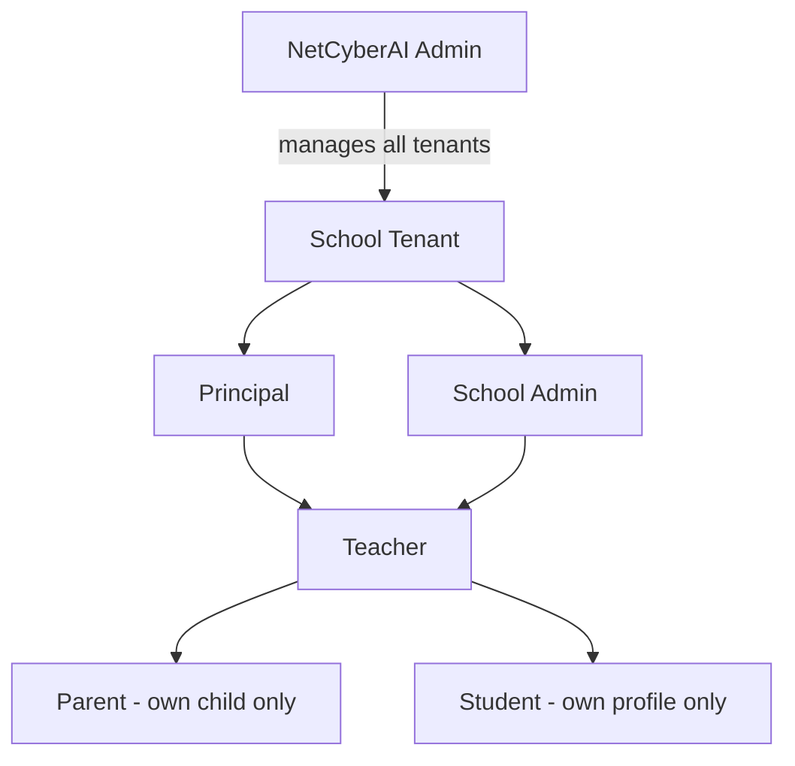

# NETCYBERAI — CENTRALIZED SCHOOL MANAGEMENT, BACKUP & DISASTER RECOVERY DESIGN

**Document ID:** NCA-OPS-003
**Version:** 1.0
**Status:** DESIGN SPECIFICATION — Phase 2 Platform (per `docs/VISION/PRODUCT_CONSTITUTION_v1.0.md` §17)
**Audience:** Engineering team implementing the multi-tenant platform; operations team responsible for platform reliability
**Related documents:** `NCA-ARCH-001` (system architecture), `NCA-AUDIT-002` (audit trail design), `PRODUCT_CONSTITUTION_v1.0.md` §9 (Compliance & Data Sovereignty)

---

## 1. Purpose & Scope

This document specifies the NetCyberAI Control Plane's centralized school management architecture and the complete backup/disaster recovery framework protecting all tenant data. It defines how the internal NetCyberAI team onboards, monitors, and administers schools across the platform, and the concrete mechanisms ensuring data survives infrastructure failure, human error, or catastrophic loss.

**Design principle carried forward from the pilot:** the pilot's backup/restore discipline (CLAUDE.md §19, tested end-to-end in Session 01 — 14-day local retention, verified restore procedure) is the seed of this design, generalized to platform scale with off-site replication and formal RTO/RPO targets.

---

## 2. Control Plane Architecture

### 2.1 Component Overview

### 2.2 School Onboarding Wizard — Workflow

**Design constraint carried forward from the pilot's secrets-handling discipline (CLAUDE.md §15, `.claude/skills/secrets-handling/SKILL.md`):** initial admin credentials are never transmitted in plaintext over any channel that persists in a searchable log (no plaintext email, no chat). Delivery uses a one-time-view secure link or a forced password reset on first login.

### 2.3 Service Plan Manager

Feature flags are the mechanism by which plan tiers (Starter/Growth/Premium, per the original business plan's ₹3k/₹8k/₹15k pricing ladder) gate module access. Flags are stored per-tenant in a `school_feature_flags` table (`school_id`, `feature_key`, `enabled`, `enabled_at`, `enabled_by`), checked at the API authorization layer before any module-specific endpoint executes — not merely hidden in the UI, since a hidden-but-reachable endpoint is a real security gap.

### 2.4 Billing & Subscription Tracker

Tracks plan tier, payment status, renewal date, and payment history per tenant, integrated with the Razorpay adapter (`NCA-ARCH-001` §2, C9) for automated payment reconciliation. Overdue subscriptions trigger a graduated response: reminder → grace period → feature degradation (never abrupt full lockout, which risks losing student data access mid-dispute) → suspension after a defined grace period, all changes logged per `NCA-AUDIT-002`'s `administrative` category.

### 2.5 Global Analytics Dashboard

Aggregates cross-tenant metrics for the NetCyberAI team: active tenant count, Pulse open rate distribution across schools (the platform's primary success metric, per Constitution §5, viewed in aggregate), support ticket volume trends, and infrastructure health summary. This dashboard reads from the same audit and communication logs as tenant-level reporting but aggregates across `school_id` — access restricted to `netcyberai_admin` role only, per `NCA-AUDIT-002` §8's access control matrix.

### 2.6 Support Ticket System

Escalations from any school route to a shared queue visible to the NetCyberAI team, tagged by severity (reusing the same severity taxonomy as `NCA-AUDIT-002` §4 for consistency) and by tenant. Any NetCyberAI staff action taken on behalf of a school (e.g., impersonating a school admin account for support purposes) is a distinct, explicitly-audited event type — impersonation sessions are time-boxed, require a stated reason logged before access is granted, and are visible to the school's own admin as a transparency measure (extending `NCA-AUDIT-002` §6.2's self-referential audit principle to support access specifically).

---

## 3. Multi-Tenant School Administration Features

| Feature | Description |
|---|---|
| Per-school configuration | Academic year dates, holiday calendar, grading scheme, fee categories — all tenant-scoped, editable only by that school's admin or principal role |
| Cross-school reporting (NetCyberAI-only) | Aggregate views across tenants for the central team; never exposed to any single school's admin |
| Bulk user management | CSV-based bulk import for students, teachers, and parent contacts, with the same validation/normalization pipeline as individual record creation (`NCA-ARCH-001` §4.1) — no bypass of validation for bulk operations |
| Tenant status lifecycle | `pilot` → `active` → `suspended` → `churned`, each transition logged, each state gating specific platform behaviors (e.g., `pilot` status defaults `pilot_test_mode=true`, inherited directly from the current pilot's whitelist-gating discipline) |

---

## 4. User Permission Management

### 4.1 Role Hierarchy

### 4.2 Permission Model

Role-based access control (RBAC) with these principles:
- Every permission check happens server-side (Core API), never trusted from client-supplied role claims alone — the JWT's role claim is verified against the current database state of the user's role on every request, not cached indefinitely, so a demoted admin loses access immediately rather than at next token expiry.
- Permissions are additive within a school (Principal implicitly has all Admin permissions plus approval powers) but never cross tenant boundaries regardless of role level (a Principal at School A has zero permissions at School B — enforced by RLS, per `NCA-ARCH-001` §9.2).
- Permission changes are themselves audited events (`NCA-AUDIT-002` §2, `administrative` category), capturing who changed whose role, from what to what, and when.

---

## 5. Platform-Wide Monitoring Tools

| Tool | Purpose | Alert threshold |
|---|---|---|
| Uptime monitor | Synthetic health checks per component (`NCA-ARCH-001` §9.6) | Any component down > 2 consecutive checks (60s) |
| Error rate dashboard | Real-time `audit_log` system_error tally by severity | Critical event → immediate alert; High → alert within 5 min |
| Queue depth monitor | `processing_queue` backlog size, per-tenant and aggregate | Backlog exceeding expected 60-second drain rate for 3+ consecutive cycles |
| Messaging delivery rate | WhatsApp/SMS/Email delivery success % over rolling 1-hour window | Delivery success rate drops below 90% |
| Database health | Connection pool saturation, replication lag (once read replicas exist), disk usage | Connection pool > 80% utilized; disk usage > 75% |

---

## 6. Data Backup & Recovery Strategy

### 6.1 Backup Schedule

| Backup type | Frequency | Retention | Scope |
|---|---|---|---|
| Full database backup | Daily, 02:00 IST (low-traffic window) | 30 days | Entire `PostgreSQL` instance, all tenants |
| Incremental (WAL archiving) | Continuous | 7 days rolling | Enables point-in-time recovery between full backups |
| Object storage (C8) snapshot | Daily | 30 days | Documents, certificates, uploaded media |
| Configuration backup | On every change (feature flags, tenant config) | 90 days | `schools`, `school_feature_flags`, and related config tables |

**This generalizes the pilot's existing weekly full-backup discipline (CLAUDE.md §19, `infrastructure/backup.sh`) to daily-plus-continuous at platform scale**, where the blast radius of data loss spans multiple paying tenants rather than one pilot school.

### 6.2 Off-Site Storage Requirements

- Primary backups stored in the same region as production (India-resident, per Constitution §9) for fast recovery.
- **Geo-redundant secondary copy** stored in a separate physical facility (different data center, same country to preserve DPDP data-residency compliance — e.g., primary in Mumbai region, secondary in a different Indian availability zone if the cloud provider offers one, or a second India-based provider entirely).
- Backup encryption at rest using a key managed separately from the database's own encryption keys (key compromise in one system should not compromise the other).

### 6.3 Recovery Time Objective (RTO) & Recovery Point Objective (RPO)

| Scenario | RTO (max time to restore service) | RPO (max acceptable data loss) |
|---|---|---|
| Single-component failure (e.g., API server crash) | < 5 minutes (automated failover/restart) | Zero (no data loss — stateless component) |
| Database primary failure | < 1 hour | < 15 minutes (via continuous WAL archiving) |
| Full regional outage | < 4 hours | < 1 hour |
| Catastrophic data corruption (application-level bug corrupting data) | < 8 hours (requires point-in-time recovery to pre-corruption state, plus manual verification) | Depends on detection lag — this is why data integrity verification (§6.5) matters as much as backup frequency |

These targets are deliberately more conservative than a well-funded enterprise SaaS (which might target RTO < 15 minutes) because the platform's actual operating constraint (per Constitution §13 and the Bridge Strategy in §14) is a small team, not a 24/7 SRE org. Targets should be revisited upward in ambition as the team and infrastructure budget grow — documented here as Phase 2 targets, not permanent ceilings.

### 6.4 Disaster Recovery Testing Protocol

| Test | Frequency | Procedure |
|---|---|---|
| Backup restore drill | Monthly | Restore the most recent full backup to an isolated test environment; verify schema integrity, spot-check row counts against production, verify application boots against restored data |
| Point-in-time recovery drill | Quarterly | Simulate a "restore to 2 hours ago" scenario using WAL archives; measure actual time taken against the RTO targets in §6.3 |
| Full failover drill (game day) | Semi-annually, once multi-region infrastructure exists | Simulate full primary region loss; execute the documented failover runbook; measure actual RTO/RPO achieved vs. targets; document gaps |
| Backup integrity spot-check | Weekly, automated | Automated job restores a backup to a throwaway instance and runs a checksum/row-count comparison against a known-good baseline, without human involvement — catches silent backup corruption between full drills |

This directly extends the pilot's own tested restore procedure (Session 01: "Restore script tested end-to-end") from a manual one-time verification into a recurring, scheduled discipline appropriate for live tenant data.

### 6.5 Data Integrity Verification

- **Checksum validation:** every backup file's checksum recorded at creation time and re-verified before any restore operation — a backup that fails checksum validation triggers an immediate critical-severity alert (per `NCA-AUDIT-002` §4) rather than being silently used.
- **Row-count reconciliation:** post-restore, automated comparison of row counts per table against the pre-backup snapshot, with any material discrepancy blocking the restore from being marked "verified."
- **Application-level smoke test:** after any restore (drill or real), a scripted sequence exercises the core admission → fee → messaging pipeline (the same synthetic transaction described in `NCA-ARCH-001` §9.6) against the restored environment before it's considered production-ready.

---

## 7. Additional Requirements & Gap Analysis

### 7.1 Tenant Offboarding & Data Deletion
When a school leaves the platform, a documented offboarding workflow: (1) full data export delivered to the school per Constitution §9's Export Center requirement, (2) confirmation window (e.g., 30 days) during which data remains recoverable in case of accidental churn, (3) after the window, a formal, audited deletion pass across primary database, backups, and object storage — never a silent drop from a single table.

### 7.2 Multi-Region Consideration (Future, Not Phase 2 Requirement)
The RTO/RPO targets in §6.3 assume single-region infrastructure for Phase 2. Multi-region active-active is explicitly out of scope until tenant count and revenue justify the added operational complexity — documented here so the schema and backup tooling don't need retrofitting later, but not built prematurely (consistent with the anti-over-engineering stance in `NCA-ARCH-001` §7).

### 7.3 Backup Access Control
Backup files themselves are among the most sensitive artifacts in the entire system (a full database dump contains every tenant's data). Access to backup storage is restricted to a minimal set of operations roles, itself logged per `NCA-AUDIT-002`, and backup files are never downloadable through any general-purpose admin UI — only through a dedicated, heavily-audited recovery tooling path.

### 7.4 Incident Communication Plan
In the event of an outage or data incident affecting one or more schools, a documented communication protocol (who notifies affected principals, what information is shared, what is held pending investigation) prevents ad-hoc, inconsistent incident communication — this is an operational gap neither the original requirement nor prior documents addressed, and is a direct trust-preservation requirement given the platform's mission (Constitution §1).

---

## 8. Success Criteria Summary

| Component | Success Criteria |
|---|---|
| School onboarding | New tenant fully provisioned (schema-scoped, credentials issued, default config seeded) within 10 minutes of wizard completion |
| Feature flag enforcement | 100% of plan-gated endpoints reject access when the corresponding flag is disabled, verified by automated tests per plan tier |
| Support impersonation | 100% of impersonation sessions are time-boxed, reason-logged, and visible to the affected school's admin |
| Backup completeness | 100% of scheduled backups complete successfully; any failure triggers immediate critical-severity alert, not silent skip |
| Backup integrity | Weekly automated restore-and-verify job passes with zero unresolved discrepancies |
| RTO/RPO adherence | Quarterly PITR drill measures actual recovery time within the targets defined in §6.3, with any miss documented and remediated |
| Tenant offboarding | 100% of offboarding requests produce a verified data export before any deletion proceeds |

---

*End of NCA-OPS-003. See `NCA-ARCH-001` for system architecture; `NCA-AUDIT-002` for audit trail and logging design.*
