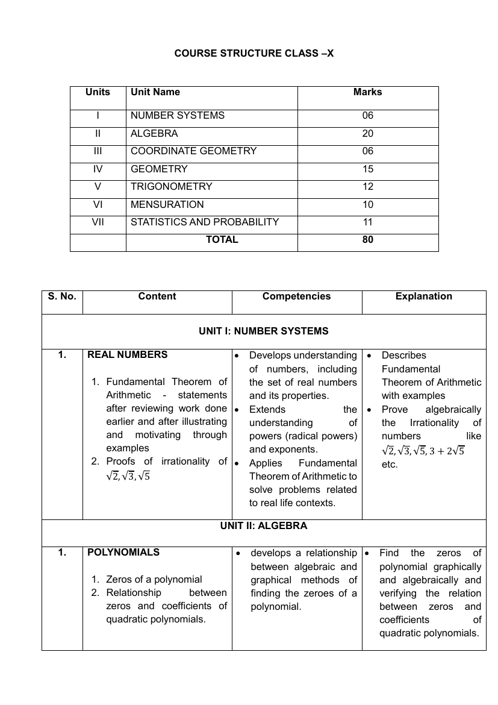

# Catalog proof: CBSE Class X Mathematics, 2026-27

Compare CBSE's page (left) with our list (right), then approve or reject this version in Control → Content. How:
[README](README.md).

| | |
|---|---|
| **CBSE document** | Mathematics, Class X, 2026-27: linked from https://cbseacademic.nic.in/curriculum_2027.html under "Secondary Curriculum: Part - 1 (Class X)" → "Main Subjects" → "Mathematics" |
| **Source URL** | https://cbseacademic.nic.in/web_material/CurriculumMain27/SecPart1/Maths_SecP1X_2026-27.pdf |
| **Page in the picture** | 3, the course structure (the PDF's own page number: its first page is 1) |
| **Fetched** | 2026-10-21, from the source URL above |
| **Our list** | Every line of [`data/catalog/cbse-2026-27-maths-science.csv`](../../../data/catalog/cbse-2026-27-maths-science.csv) for this version: 7 units, 15 chapters, 34 topics, in the order printed. Each line links to its page in CBSE's PDF. |
| **Hindi titles** | 0 of 56 lines. CBSE's 2026-27 curriculum page links no Hindi version of this document (checked 2026-10-21), so the app shows the English titles; nothing was translated (see [the catalog README](../../../data/catalog/README.md)). |

The course structure table names the units. The chapters and their numbered items (topics) are on pages 3–7: follow each page link.

<table>
<tr><th>CBSE, page 3</th><th>Our list</th></tr>
<tr>
<td width="50%" valign="top"></td>
<td width="50%" valign="top">

<ol>
<li><b>Unit: NUMBER SYSTEMS <a href="https://cbseacademic.nic.in/web_material/CurriculumMain27/SecPart1/Maths_SecP1X_2026-27.pdf#page=3">p.&nbsp;3</a></b>
<ol>
<li>REAL NUMBERS <a href="https://cbseacademic.nic.in/web_material/CurriculumMain27/SecPart1/Maths_SecP1X_2026-27.pdf#page=3">p.&nbsp;3</a>
<ol>
<li>Fundamental Theorem of Arithmetic - statements after reviewing work done earlier and after illustrating and motivating through examples <a href="https://cbseacademic.nic.in/web_material/CurriculumMain27/SecPart1/Maths_SecP1X_2026-27.pdf#page=3">p.&nbsp;3</a></li>
<li>Proofs of irrationality of √2, √3, √5 <a href="https://cbseacademic.nic.in/web_material/CurriculumMain27/SecPart1/Maths_SecP1X_2026-27.pdf#page=3">p.&nbsp;3</a></li>
</ol>
</li>
</ol>
</li>
<li><b>Unit: ALGEBRA <a href="https://cbseacademic.nic.in/web_material/CurriculumMain27/SecPart1/Maths_SecP1X_2026-27.pdf#page=3">p.&nbsp;3</a></b>
<ol>
<li>POLYNOMIALS <a href="https://cbseacademic.nic.in/web_material/CurriculumMain27/SecPart1/Maths_SecP1X_2026-27.pdf#page=3">p.&nbsp;3</a>
<ol>
<li>Zeros of a polynomial <a href="https://cbseacademic.nic.in/web_material/CurriculumMain27/SecPart1/Maths_SecP1X_2026-27.pdf#page=3">p.&nbsp;3</a></li>
<li>Relationship between zeros and coefficients of quadratic polynomials. <a href="https://cbseacademic.nic.in/web_material/CurriculumMain27/SecPart1/Maths_SecP1X_2026-27.pdf#page=3">p.&nbsp;3</a></li>
</ol>
</li>
<li>PAIR OF LINEAR EQUATIONS IN TWO VARIABLES <a href="https://cbseacademic.nic.in/web_material/CurriculumMain27/SecPart1/Maths_SecP1X_2026-27.pdf#page=4">p.&nbsp;4</a>
<ol>
<li>Pair of linear equations in two variables and graphical method of their solution, consistency/inconsistency. <a href="https://cbseacademic.nic.in/web_material/CurriculumMain27/SecPart1/Maths_SecP1X_2026-27.pdf#page=4">p.&nbsp;4</a></li>
<li>Algebraic conditions for number of solutions. <a href="https://cbseacademic.nic.in/web_material/CurriculumMain27/SecPart1/Maths_SecP1X_2026-27.pdf#page=4">p.&nbsp;4</a></li>
<li>Solution of a pair of linear equations in two variables algebraically - by substitution, by elimination. Simple situational problems. <a href="https://cbseacademic.nic.in/web_material/CurriculumMain27/SecPart1/Maths_SecP1X_2026-27.pdf#page=4">p.&nbsp;4</a></li>
</ol>
</li>
<li>QUADRATIC EQUATIONS <a href="https://cbseacademic.nic.in/web_material/CurriculumMain27/SecPart1/Maths_SecP1X_2026-27.pdf#page=4">p.&nbsp;4</a>
<ol>
<li>Standard form of a quadratic equation ax² + bx + c = 0, (a ≠ 0). <a href="https://cbseacademic.nic.in/web_material/CurriculumMain27/SecPart1/Maths_SecP1X_2026-27.pdf#page=4">p.&nbsp;4</a></li>
<li>Solutions of quadratic equations (only real roots) by factorization, and by using quadratic formula. Relationship between discriminant and nature of roots. <a href="https://cbseacademic.nic.in/web_material/CurriculumMain27/SecPart1/Maths_SecP1X_2026-27.pdf#page=4">p.&nbsp;4</a></li>
<li>Situational problems based on quadratic equations related to day-to-day activities to be incorporated <a href="https://cbseacademic.nic.in/web_material/CurriculumMain27/SecPart1/Maths_SecP1X_2026-27.pdf#page=4">p.&nbsp;4</a></li>
</ol>
</li>
<li>ARITHMETIC PROGRESSIONS <a href="https://cbseacademic.nic.in/web_material/CurriculumMain27/SecPart1/Maths_SecP1X_2026-27.pdf#page=4">p.&nbsp;4</a>
<ol>
<li>Motivation for studying Arithmetic Progression <a href="https://cbseacademic.nic.in/web_material/CurriculumMain27/SecPart1/Maths_SecP1X_2026-27.pdf#page=4">p.&nbsp;4</a></li>
<li>Derivation of the nth term and sum of the first n terms of AP and their application in solving daily life problems. <a href="https://cbseacademic.nic.in/web_material/CurriculumMain27/SecPart1/Maths_SecP1X_2026-27.pdf#page=4">p.&nbsp;4</a></li>
</ol>
</li>
</ol>
</li>
<li><b>Unit: COORDINATE GEOMETRY <a href="https://cbseacademic.nic.in/web_material/CurriculumMain27/SecPart1/Maths_SecP1X_2026-27.pdf#page=3">p.&nbsp;3</a></b>
<ol>
<li>Coordinate Geometry <a href="https://cbseacademic.nic.in/web_material/CurriculumMain27/SecPart1/Maths_SecP1X_2026-27.pdf#page=5">p.&nbsp;5</a>
<ol>
<li>Review: Concepts of coordinate geometry. Distance formula. Section formula (internal division). <a href="https://cbseacademic.nic.in/web_material/CurriculumMain27/SecPart1/Maths_SecP1X_2026-27.pdf#page=5">p.&nbsp;5</a></li>
</ol>
</li>
</ol>
</li>
<li><b>Unit: GEOMETRY <a href="https://cbseacademic.nic.in/web_material/CurriculumMain27/SecPart1/Maths_SecP1X_2026-27.pdf#page=3">p.&nbsp;3</a></b>
<ol>
<li>TRIANGLES <a href="https://cbseacademic.nic.in/web_material/CurriculumMain27/SecPart1/Maths_SecP1X_2026-27.pdf#page=5">p.&nbsp;5</a>
<ol>
<li>Definitions, examples, counter examples of similar triangles. <a href="https://cbseacademic.nic.in/web_material/CurriculumMain27/SecPart1/Maths_SecP1X_2026-27.pdf#page=5">p.&nbsp;5</a></li>
<li>(Prove) If a line is drawn parallel to one side of a triangle to intersect the other two sides in distinct points, the other two sides are divided in the same ratio. <a href="https://cbseacademic.nic.in/web_material/CurriculumMain27/SecPart1/Maths_SecP1X_2026-27.pdf#page=5">p.&nbsp;5</a></li>
<li>State (without proof) If a line divides two sides of a triangle in the same ratio, the line is parallel to the third side. <a href="https://cbseacademic.nic.in/web_material/CurriculumMain27/SecPart1/Maths_SecP1X_2026-27.pdf#page=5">p.&nbsp;5</a></li>
<li>State (without proof) If in two triangles, the corresponding angles are equal, their corresponding sides are proportional and the triangles are similar. <a href="https://cbseacademic.nic.in/web_material/CurriculumMain27/SecPart1/Maths_SecP1X_2026-27.pdf#page=5">p.&nbsp;5</a></li>
<li>State (without proof) If the corresponding sides of two triangles are proportional, their corresponding angles are equal and the two triangles are similar. <a href="https://cbseacademic.nic.in/web_material/CurriculumMain27/SecPart1/Maths_SecP1X_2026-27.pdf#page=5">p.&nbsp;5</a></li>
<li>State (without proof) If one angle of a triangle is equal to one angle of another triangle and the sides including these angles are proportional, the two triangles are similar. <a href="https://cbseacademic.nic.in/web_material/CurriculumMain27/SecPart1/Maths_SecP1X_2026-27.pdf#page=5">p.&nbsp;5</a></li>
</ol>
</li>
<li>CIRCLES <a href="https://cbseacademic.nic.in/web_material/CurriculumMain27/SecPart1/Maths_SecP1X_2026-27.pdf#page=6">p.&nbsp;6</a>
<ol>
<li>Tangent to a circle at point of contact. <a href="https://cbseacademic.nic.in/web_material/CurriculumMain27/SecPart1/Maths_SecP1X_2026-27.pdf#page=6">p.&nbsp;6</a></li>
<li>(Prove) The tangent at any point of a circle is perpendicular to the radius through the point of contact. <a href="https://cbseacademic.nic.in/web_material/CurriculumMain27/SecPart1/Maths_SecP1X_2026-27.pdf#page=6">p.&nbsp;6</a></li>
<li>(Prove) The lengths of tangents drawn from an external point to a circle are equal. <a href="https://cbseacademic.nic.in/web_material/CurriculumMain27/SecPart1/Maths_SecP1X_2026-27.pdf#page=6">p.&nbsp;6</a></li>
</ol>
</li>
</ol>
</li>
<li><b>Unit: TRIGONOMETRY <a href="https://cbseacademic.nic.in/web_material/CurriculumMain27/SecPart1/Maths_SecP1X_2026-27.pdf#page=3">p.&nbsp;3</a></b>
<ol>
<li>INTRODUCTION TO TRIGONOMETRY <a href="https://cbseacademic.nic.in/web_material/CurriculumMain27/SecPart1/Maths_SecP1X_2026-27.pdf#page=6">p.&nbsp;6</a>
<ol>
<li>Trigonometric ratios of an acute angle of a right-angled triangle. Proof of their existence (well defined) <a href="https://cbseacademic.nic.in/web_material/CurriculumMain27/SecPart1/Maths_SecP1X_2026-27.pdf#page=6">p.&nbsp;6</a></li>
<li>Motivate the ratios whichever are defined at 0° and 90°. Values of the trigonometric ratios of 30°, 45° and 60°. <a href="https://cbseacademic.nic.in/web_material/CurriculumMain27/SecPart1/Maths_SecP1X_2026-27.pdf#page=6">p.&nbsp;6</a></li>
<li>Relationships between the ratios. <a href="https://cbseacademic.nic.in/web_material/CurriculumMain27/SecPart1/Maths_SecP1X_2026-27.pdf#page=6">p.&nbsp;6</a></li>
</ol>
</li>
<li>TRIGONOMETRIC IDENTITIES <a href="https://cbseacademic.nic.in/web_material/CurriculumMain27/SecPart1/Maths_SecP1X_2026-27.pdf#page=6">p.&nbsp;6</a>
<ol>
<li>Proof and applications of the identity sin² A + cos² A = 1. <a href="https://cbseacademic.nic.in/web_material/CurriculumMain27/SecPart1/Maths_SecP1X_2026-27.pdf#page=6">p.&nbsp;6</a></li>
<li>Only simple identities to be given. <a href="https://cbseacademic.nic.in/web_material/CurriculumMain27/SecPart1/Maths_SecP1X_2026-27.pdf#page=6">p.&nbsp;6</a></li>
</ol>
</li>
<li>HEIGHTS AND DISTANCES: Angle of elevation, Angle of Depression. <a href="https://cbseacademic.nic.in/web_material/CurriculumMain27/SecPart1/Maths_SecP1X_2026-27.pdf#page=6">p.&nbsp;6</a>
<ol>
<li>Simple problems on heights and distances. Problems should not involve more than two right triangles. Angles of elevation / depression should be only 30°, 45°, and 60°. <a href="https://cbseacademic.nic.in/web_material/CurriculumMain27/SecPart1/Maths_SecP1X_2026-27.pdf#page=6">p.&nbsp;6</a></li>
</ol>
</li>
</ol>
</li>
<li><b>Unit: MENSURATION <a href="https://cbseacademic.nic.in/web_material/CurriculumMain27/SecPart1/Maths_SecP1X_2026-27.pdf#page=3">p.&nbsp;3</a></b>
<ol>
<li>AREAS RELATED TO CIRCLES <a href="https://cbseacademic.nic.in/web_material/CurriculumMain27/SecPart1/Maths_SecP1X_2026-27.pdf#page=7">p.&nbsp;7</a>
<ol>
<li>Area of sectors and segments of a circle. <a href="https://cbseacademic.nic.in/web_material/CurriculumMain27/SecPart1/Maths_SecP1X_2026-27.pdf#page=7">p.&nbsp;7</a></li>
<li>Problems based on areas and perimeter /circumference of the above said plane figures. (In calculating area of segment of a circle, problems should be restricted to central angle of 60°, 90° and 120° only. <a href="https://cbseacademic.nic.in/web_material/CurriculumMain27/SecPart1/Maths_SecP1X_2026-27.pdf#page=7">p.&nbsp;7</a></li>
</ol>
</li>
<li>SURFACE AREAS AND VOLUMES <a href="https://cbseacademic.nic.in/web_material/CurriculumMain27/SecPart1/Maths_SecP1X_2026-27.pdf#page=7">p.&nbsp;7</a>
<ol>
<li>Surface areas and volumes of combinations of any two of the following: cubes, cuboids, spheres, hemispheres and right circular cylinders/cones. <a href="https://cbseacademic.nic.in/web_material/CurriculumMain27/SecPart1/Maths_SecP1X_2026-27.pdf#page=7">p.&nbsp;7</a></li>
</ol>
</li>
</ol>
</li>
<li><b>Unit: STATISTICS AND PROBABILITY <a href="https://cbseacademic.nic.in/web_material/CurriculumMain27/SecPart1/Maths_SecP1X_2026-27.pdf#page=3">p.&nbsp;3</a></b>
<ol>
<li>STATISTICS <a href="https://cbseacademic.nic.in/web_material/CurriculumMain27/SecPart1/Maths_SecP1X_2026-27.pdf#page=7">p.&nbsp;7</a>
<ol>
<li>Mean, median and mode of grouped data (bimodal situation to be avoided). <a href="https://cbseacademic.nic.in/web_material/CurriculumMain27/SecPart1/Maths_SecP1X_2026-27.pdf#page=7">p.&nbsp;7</a></li>
</ol>
</li>
<li>PROBABILITY <a href="https://cbseacademic.nic.in/web_material/CurriculumMain27/SecPart1/Maths_SecP1X_2026-27.pdf#page=7">p.&nbsp;7</a>
<ol>
<li>Classical definition of probability. <a href="https://cbseacademic.nic.in/web_material/CurriculumMain27/SecPart1/Maths_SecP1X_2026-27.pdf#page=7">p.&nbsp;7</a></li>
<li>Simple problems on finding the probability of an event. <a href="https://cbseacademic.nic.in/web_material/CurriculumMain27/SecPart1/Maths_SecP1X_2026-27.pdf#page=7">p.&nbsp;7</a></li>
</ol>
</li>
</ol>
</li>
</ol>

</td>
</tr>
</table>
