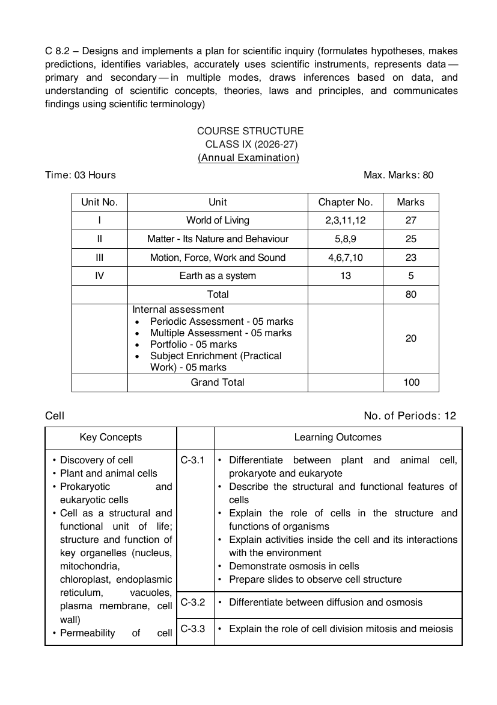

# Catalog proof: CBSE Class IX Science, 2026-27

Compare CBSE's page (left) with our list (right), then approve or reject this version in Control → Content. How:
[README](README.md).

| | |
|---|---|
| **CBSE document** | Science, Class IX, 2026-27: linked from https://cbseacademic.nic.in/curriculum_2027.html under "Secondary Curriculum: Part - 1 (Class IX)" → "Main Subjects" → "Science" |
| **Source URL** | https://cbseacademic.nic.in/web_material/CurriculumMain27/SecPart1/ScienceSt_SecP1_2026-27.pdf |
| **Page in the picture** | 4, the course structure (the PDF's own page number: its first page is 1) |
| **Fetched** | 2026-10-21, from the source URL above |
| **Our list** | Every line of [`data/catalog/cbse-2026-27-maths-science.csv`](../../../data/catalog/cbse-2026-27-maths-science.csv) for this version: 4 units, 12 chapters, 78 topics, in the order printed. Each line links to its page in CBSE's PDF. |
| **Hindi titles** | 0 of 94 lines. CBSE's 2026-27 curriculum page links no Hindi version of this document (checked 2026-10-21), so the app shows the English titles; nothing was translated (see [the catalog README](../../../data/catalog/README.md)). |

The course structure table names the units and their textbook chapter numbers. The chapters and their "Key Concepts" (topics) are on pages 4–18: follow each page link.

<table>
<tr><th>CBSE, page 4</th><th>Our list</th></tr>
<tr>
<td width="50%" valign="top"></td>
<td width="50%" valign="top">

<ol>
<li><b>Unit: World of Living <a href="https://cbseacademic.nic.in/web_material/CurriculumMain27/SecPart1/ScienceSt_SecP1_2026-27.pdf#page=4">p.&nbsp;4</a></b>
<ol>
<li>Cell <a href="https://cbseacademic.nic.in/web_material/CurriculumMain27/SecPart1/ScienceSt_SecP1_2026-27.pdf#page=4">p.&nbsp;4</a>
<ol>
<li>Discovery of cell <a href="https://cbseacademic.nic.in/web_material/CurriculumMain27/SecPart1/ScienceSt_SecP1_2026-27.pdf#page=4">p.&nbsp;4</a></li>
<li>Plant and animal cells <a href="https://cbseacademic.nic.in/web_material/CurriculumMain27/SecPart1/ScienceSt_SecP1_2026-27.pdf#page=4">p.&nbsp;4</a></li>
<li>Prokaryotic and eukaryotic cells <a href="https://cbseacademic.nic.in/web_material/CurriculumMain27/SecPart1/ScienceSt_SecP1_2026-27.pdf#page=4">p.&nbsp;4</a></li>
<li>Cell as a structural and functional unit of life; structure and function of key organelles (nucleus, mitochondria, chloroplast, endoplasmic reticulum, vacuoles, plasma membrane, cell wall) <a href="https://cbseacademic.nic.in/web_material/CurriculumMain27/SecPart1/ScienceSt_SecP1_2026-27.pdf#page=4">p.&nbsp;4</a></li>
<li>Permeability of cell membranes <a href="https://cbseacademic.nic.in/web_material/CurriculumMain27/SecPart1/ScienceSt_SecP1_2026-27.pdf#page=4">p.&nbsp;4-5</a></li>
<li>Cellular division and cancer <a href="https://cbseacademic.nic.in/web_material/CurriculumMain27/SecPart1/ScienceSt_SecP1_2026-27.pdf#page=5">p.&nbsp;5</a></li>
<li>Recent advancement in cell biology <a href="https://cbseacademic.nic.in/web_material/CurriculumMain27/SecPart1/ScienceSt_SecP1_2026-27.pdf#page=5">p.&nbsp;5</a></li>
</ol>
</li>
<li>Tissues <a href="https://cbseacademic.nic.in/web_material/CurriculumMain27/SecPart1/ScienceSt_SecP1_2026-27.pdf#page=5">p.&nbsp;5</a>
<ol>
<li>Tissues: Introduction and importance <a href="https://cbseacademic.nic.in/web_material/CurriculumMain27/SecPart1/ScienceSt_SecP1_2026-27.pdf#page=5">p.&nbsp;5</a></li>
<li>Level of organisation in the living organisms <a href="https://cbseacademic.nic.in/web_material/CurriculumMain27/SecPart1/ScienceSt_SecP1_2026-27.pdf#page=5">p.&nbsp;5</a></li>
<li>Plant and animal tissues <a href="https://cbseacademic.nic.in/web_material/CurriculumMain27/SecPart1/ScienceSt_SecP1_2026-27.pdf#page=5">p.&nbsp;5</a></li>
<li>Types of plant tissues <a href="https://cbseacademic.nic.in/web_material/CurriculumMain27/SecPart1/ScienceSt_SecP1_2026-27.pdf#page=5">p.&nbsp;5</a></li>
<li>Meristematic tissues (types and function of each) <a href="https://cbseacademic.nic.in/web_material/CurriculumMain27/SecPart1/ScienceSt_SecP1_2026-27.pdf#page=5">p.&nbsp;5</a></li>
<li>Permanent tissues (types, structure and function of each) <a href="https://cbseacademic.nic.in/web_material/CurriculumMain27/SecPart1/ScienceSt_SecP1_2026-27.pdf#page=5">p.&nbsp;5</a></li>
<li>Animal tissues <a href="https://cbseacademic.nic.in/web_material/CurriculumMain27/SecPart1/ScienceSt_SecP1_2026-27.pdf#page=6">p.&nbsp;6</a></li>
<li>Overview (epithelial, connective, muscular and nervous tissues — types, structure and function of each) <a href="https://cbseacademic.nic.in/web_material/CurriculumMain27/SecPart1/ScienceSt_SecP1_2026-27.pdf#page=6">p.&nbsp;6</a></li>
<li>Elementary idea of musculoskeletal system <a href="https://cbseacademic.nic.in/web_material/CurriculumMain27/SecPart1/ScienceSt_SecP1_2026-27.pdf#page=6">p.&nbsp;6</a></li>
<li>Care of musculoskeletal system: injuries, postural care, nutrition and exercise <a href="https://cbseacademic.nic.in/web_material/CurriculumMain27/SecPart1/ScienceSt_SecP1_2026-27.pdf#page=6">p.&nbsp;6</a></li>
</ol>
</li>
<li>Reproduction <a href="https://cbseacademic.nic.in/web_material/CurriculumMain27/SecPart1/ScienceSt_SecP1_2026-27.pdf#page=6">p.&nbsp;6</a>
<ol>
<li>Introduction to different forms of reproduction — sexual and asexual <a href="https://cbseacademic.nic.in/web_material/CurriculumMain27/SecPart1/ScienceSt_SecP1_2026-27.pdf#page=6">p.&nbsp;6</a></li>
<li>Types of asexual reproduction with examples <a href="https://cbseacademic.nic.in/web_material/CurriculumMain27/SecPart1/ScienceSt_SecP1_2026-27.pdf#page=6">p.&nbsp;6</a></li>
<li>Sexual reproduction in flowering plants (flower and its parts, pollination, fertilisation, seed dispersal) <a href="https://cbseacademic.nic.in/web_material/CurriculumMain27/SecPart1/ScienceSt_SecP1_2026-27.pdf#page=6">p.&nbsp;6-7</a></li>
<li>Sexual reproduction in humans: male and female reproductive systems (structure and function, formation of gametes, sperm and egg, fertilisation, pregnancy and development of embryo, menstrual cycle) <a href="https://cbseacademic.nic.in/web_material/CurriculumMain27/SecPart1/ScienceSt_SecP1_2026-27.pdf#page=7">p.&nbsp;7</a></li>
<li>Reproductive health and hygiene <a href="https://cbseacademic.nic.in/web_material/CurriculumMain27/SecPart1/ScienceSt_SecP1_2026-27.pdf#page=7">p.&nbsp;7</a></li>
<li>Introduction to birth control methods and importance <a href="https://cbseacademic.nic.in/web_material/CurriculumMain27/SecPart1/ScienceSt_SecP1_2026-27.pdf#page=7">p.&nbsp;7</a></li>
</ol>
</li>
<li>Diversity <a href="https://cbseacademic.nic.in/web_material/CurriculumMain27/SecPart1/ScienceSt_SecP1_2026-27.pdf#page=7">p.&nbsp;7</a>
<ol>
<li>Importance of classification <a href="https://cbseacademic.nic.in/web_material/CurriculumMain27/SecPart1/ScienceSt_SecP1_2026-27.pdf#page=7">p.&nbsp;7</a></li>
<li>Five kingdoms and their key features with examples <a href="https://cbseacademic.nic.in/web_material/CurriculumMain27/SecPart1/ScienceSt_SecP1_2026-27.pdf#page=7">p.&nbsp;7</a></li>
<li>Major division of animals and plants <a href="https://cbseacademic.nic.in/web_material/CurriculumMain27/SecPart1/ScienceSt_SecP1_2026-27.pdf#page=7">p.&nbsp;7</a></li>
<li>Binomial nomenclature <a href="https://cbseacademic.nic.in/web_material/CurriculumMain27/SecPart1/ScienceSt_SecP1_2026-27.pdf#page=7">p.&nbsp;7</a></li>
<li>Acellular entities: viruses <a href="https://cbseacademic.nic.in/web_material/CurriculumMain27/SecPart1/ScienceSt_SecP1_2026-27.pdf#page=7">p.&nbsp;7</a></li>
</ol>
</li>
</ol>
</li>
<li><b>Unit: Matter - Its Nature and Behaviour <a href="https://cbseacademic.nic.in/web_material/CurriculumMain27/SecPart1/ScienceSt_SecP1_2026-27.pdf#page=4">p.&nbsp;4</a></b>
<ol>
<li>Exploring Mixtures and their Separation <a href="https://cbseacademic.nic.in/web_material/CurriculumMain27/SecPart1/ScienceSt_SecP1_2026-27.pdf#page=8">p.&nbsp;8</a>
<ol>
<li>Homogeneous and heterogeneous mixtures <a href="https://cbseacademic.nic.in/web_material/CurriculumMain27/SecPart1/ScienceSt_SecP1_2026-27.pdf#page=8">p.&nbsp;8</a></li>
<li>Solutions, suspensions, colloids and their properties <a href="https://cbseacademic.nic.in/web_material/CurriculumMain27/SecPart1/ScienceSt_SecP1_2026-27.pdf#page=8">p.&nbsp;8</a></li>
<li>Various ways to express concentration of solutions (mass by mass percentage of a solution, mass by volume percentage of a solution, volume by volume percentage of a solution) <a href="https://cbseacademic.nic.in/web_material/CurriculumMain27/SecPart1/ScienceSt_SecP1_2026-27.pdf#page=8">p.&nbsp;8</a></li>
<li>Separation techniques based on the physical properties of components, including crystallisation, distillation, paper chromatography, sublimation, centrifugation and coagulation <a href="https://cbseacademic.nic.in/web_material/CurriculumMain27/SecPart1/ScienceSt_SecP1_2026-27.pdf#page=8">p.&nbsp;8</a></li>
</ol>
</li>
<li>Structure of an Atom <a href="https://cbseacademic.nic.in/web_material/CurriculumMain27/SecPart1/ScienceSt_SecP1_2026-27.pdf#page=9">p.&nbsp;9</a>
<ol>
<li>Atoms are the basic units of elements <a href="https://cbseacademic.nic.in/web_material/CurriculumMain27/SecPart1/ScienceSt_SecP1_2026-27.pdf#page=9">p.&nbsp;9</a></li>
<li>Atoms consist of subatomic particles <a href="https://cbseacademic.nic.in/web_material/CurriculumMain27/SecPart1/ScienceSt_SecP1_2026-27.pdf#page=9">p.&nbsp;9</a></li>
<li>Atomic Models (Thomson’s Model, Rutherford’s Model, and Bohr’s Model) <a href="https://cbseacademic.nic.in/web_material/CurriculumMain27/SecPart1/ScienceSt_SecP1_2026-27.pdf#page=9">p.&nbsp;9</a></li>
<li>Distributions of electrons in elements (up to 18 elements) <a href="https://cbseacademic.nic.in/web_material/CurriculumMain27/SecPart1/ScienceSt_SecP1_2026-27.pdf#page=9">p.&nbsp;9</a></li>
<li>Symbols <a href="https://cbseacademic.nic.in/web_material/CurriculumMain27/SecPart1/ScienceSt_SecP1_2026-27.pdf#page=9">p.&nbsp;9</a></li>
<li>Valency as the combining capacity <a href="https://cbseacademic.nic.in/web_material/CurriculumMain27/SecPart1/ScienceSt_SecP1_2026-27.pdf#page=9">p.&nbsp;9-10</a></li>
<li>Atomic number <a href="https://cbseacademic.nic.in/web_material/CurriculumMain27/SecPart1/ScienceSt_SecP1_2026-27.pdf#page=10">p.&nbsp;10</a></li>
<li>Mass number <a href="https://cbseacademic.nic.in/web_material/CurriculumMain27/SecPart1/ScienceSt_SecP1_2026-27.pdf#page=10">p.&nbsp;10</a></li>
<li>Isotopes <a href="https://cbseacademic.nic.in/web_material/CurriculumMain27/SecPart1/ScienceSt_SecP1_2026-27.pdf#page=10">p.&nbsp;10</a></li>
<li>Isobars <a href="https://cbseacademic.nic.in/web_material/CurriculumMain27/SecPart1/ScienceSt_SecP1_2026-27.pdf#page=10">p.&nbsp;10</a></li>
</ol>
</li>
<li>Atoms and Molecules <a href="https://cbseacademic.nic.in/web_material/CurriculumMain27/SecPart1/ScienceSt_SecP1_2026-27.pdf#page=11">p.&nbsp;11</a>
<ol>
<li>Law of conservation of mass <a href="https://cbseacademic.nic.in/web_material/CurriculumMain27/SecPart1/ScienceSt_SecP1_2026-27.pdf#page=11">p.&nbsp;11</a></li>
<li>Law of constant proportion <a href="https://cbseacademic.nic.in/web_material/CurriculumMain27/SecPart1/ScienceSt_SecP1_2026-27.pdf#page=11">p.&nbsp;11</a></li>
<li>Dalton’s Atomic theory <a href="https://cbseacademic.nic.in/web_material/CurriculumMain27/SecPart1/ScienceSt_SecP1_2026-27.pdf#page=11">p.&nbsp;11</a></li>
<li>Molecules of elements, Molecules of covalent compounds and their properties <a href="https://cbseacademic.nic.in/web_material/CurriculumMain27/SecPart1/ScienceSt_SecP1_2026-27.pdf#page=11">p.&nbsp;11</a></li>
<li>Ions, Ionic compounds and their properties <a href="https://cbseacademic.nic.in/web_material/CurriculumMain27/SecPart1/ScienceSt_SecP1_2026-27.pdf#page=11">p.&nbsp;11</a></li>
<li>Writing chemical formulae <a href="https://cbseacademic.nic.in/web_material/CurriculumMain27/SecPart1/ScienceSt_SecP1_2026-27.pdf#page=11">p.&nbsp;11</a></li>
<li>Molecular mass <a href="https://cbseacademic.nic.in/web_material/CurriculumMain27/SecPart1/ScienceSt_SecP1_2026-27.pdf#page=11">p.&nbsp;11</a></li>
<li>Formula unit mass <a href="https://cbseacademic.nic.in/web_material/CurriculumMain27/SecPart1/ScienceSt_SecP1_2026-27.pdf#page=11">p.&nbsp;11</a></li>
</ol>
</li>
</ol>
</li>
<li><b>Unit: Motion, Force, Work and Sound <a href="https://cbseacademic.nic.in/web_material/CurriculumMain27/SecPart1/ScienceSt_SecP1_2026-27.pdf#page=4">p.&nbsp;4</a></b>
<ol>
<li>Motion <a href="https://cbseacademic.nic.in/web_material/CurriculumMain27/SecPart1/ScienceSt_SecP1_2026-27.pdf#page=14">p.&nbsp;14</a>
<ol>
<li>Motion — displacement, velocity, acceleration <a href="https://cbseacademic.nic.in/web_material/CurriculumMain27/SecPart1/ScienceSt_SecP1_2026-27.pdf#page=14">p.&nbsp;14</a></li>
<li>Graphical representation of motion for an object moving in a straight line in one direction (with constant velocity, and constant acceleration) <a href="https://cbseacademic.nic.in/web_material/CurriculumMain27/SecPart1/ScienceSt_SecP1_2026-27.pdf#page=14">p.&nbsp;14</a></li>
<li>Kinematic equations for motion in a straight line with constant acceleration (by graphical method) <a href="https://cbseacademic.nic.in/web_material/CurriculumMain27/SecPart1/ScienceSt_SecP1_2026-27.pdf#page=14">p.&nbsp;14</a></li>
<li>Elementary idea of uniform circular motion <a href="https://cbseacademic.nic.in/web_material/CurriculumMain27/SecPart1/ScienceSt_SecP1_2026-27.pdf#page=14">p.&nbsp;14</a></li>
</ol>
</li>
<li>Force and Laws of Motion <a href="https://cbseacademic.nic.in/web_material/CurriculumMain27/SecPart1/ScienceSt_SecP1_2026-27.pdf#page=15">p.&nbsp;15</a>
<ol>
<li>Force; balanced and unbalanced forces <a href="https://cbseacademic.nic.in/web_material/CurriculumMain27/SecPart1/ScienceSt_SecP1_2026-27.pdf#page=15">p.&nbsp;15</a></li>
<li>Force of friction <a href="https://cbseacademic.nic.in/web_material/CurriculumMain27/SecPart1/ScienceSt_SecP1_2026-27.pdf#page=15">p.&nbsp;15</a></li>
<li>Newton’s first law of motion <a href="https://cbseacademic.nic.in/web_material/CurriculumMain27/SecPart1/ScienceSt_SecP1_2026-27.pdf#page=15">p.&nbsp;15</a></li>
<li>Newton’s second law of motion <a href="https://cbseacademic.nic.in/web_material/CurriculumMain27/SecPart1/ScienceSt_SecP1_2026-27.pdf#page=15">p.&nbsp;15</a></li>
<li>Newton’s third law of motion <a href="https://cbseacademic.nic.in/web_material/CurriculumMain27/SecPart1/ScienceSt_SecP1_2026-27.pdf#page=15">p.&nbsp;15</a></li>
</ol>
</li>
<li>Work, Energy and Simple Machines <a href="https://cbseacademic.nic.in/web_material/CurriculumMain27/SecPart1/ScienceSt_SecP1_2026-27.pdf#page=16">p.&nbsp;16</a>
<ol>
<li>Concept of work; work done by a constant force <a href="https://cbseacademic.nic.in/web_material/CurriculumMain27/SecPart1/ScienceSt_SecP1_2026-27.pdf#page=16">p.&nbsp;16</a></li>
<li>Work-Energy theorem <a href="https://cbseacademic.nic.in/web_material/CurriculumMain27/SecPart1/ScienceSt_SecP1_2026-27.pdf#page=16">p.&nbsp;16</a></li>
<li>Mechanical energy, kinetic and potential energy, and conversion between potential energy and kinetic energy <a href="https://cbseacademic.nic.in/web_material/CurriculumMain27/SecPart1/ScienceSt_SecP1_2026-27.pdf#page=16">p.&nbsp;16</a></li>
<li>Conservation of energy <a href="https://cbseacademic.nic.in/web_material/CurriculumMain27/SecPart1/ScienceSt_SecP1_2026-27.pdf#page=16">p.&nbsp;16</a></li>
<li>Power <a href="https://cbseacademic.nic.in/web_material/CurriculumMain27/SecPart1/ScienceSt_SecP1_2026-27.pdf#page=16">p.&nbsp;16</a></li>
<li>Simple machines and their mechanical advantage (pulley, inclined plane, lever) <a href="https://cbseacademic.nic.in/web_material/CurriculumMain27/SecPart1/ScienceSt_SecP1_2026-27.pdf#page=16">p.&nbsp;16</a></li>
</ol>
</li>
<li>Sound <a href="https://cbseacademic.nic.in/web_material/CurriculumMain27/SecPart1/ScienceSt_SecP1_2026-27.pdf#page=17">p.&nbsp;17</a>
<ol>
<li>Production of sound <a href="https://cbseacademic.nic.in/web_material/CurriculumMain27/SecPart1/ScienceSt_SecP1_2026-27.pdf#page=17">p.&nbsp;17</a></li>
<li>Propagation of sound (as a longitudinal wave through a medium) <a href="https://cbseacademic.nic.in/web_material/CurriculumMain27/SecPart1/ScienceSt_SecP1_2026-27.pdf#page=17">p.&nbsp;17</a></li>
<li>Graphical representation of sound wave <a href="https://cbseacademic.nic.in/web_material/CurriculumMain27/SecPart1/ScienceSt_SecP1_2026-27.pdf#page=17">p.&nbsp;17</a></li>
<li>Characteristics of sound wave (wavelength, frequency, time period, amplitude, intensity, speed) <a href="https://cbseacademic.nic.in/web_material/CurriculumMain27/SecPart1/ScienceSt_SecP1_2026-27.pdf#page=17">p.&nbsp;17</a></li>
<li>Human perception of sound (pitch, loudness) <a href="https://cbseacademic.nic.in/web_material/CurriculumMain27/SecPart1/ScienceSt_SecP1_2026-27.pdf#page=18">p.&nbsp;18</a></li>
<li>Propagation of sound in different media (solid, liquid) <a href="https://cbseacademic.nic.in/web_material/CurriculumMain27/SecPart1/ScienceSt_SecP1_2026-27.pdf#page=18">p.&nbsp;18</a></li>
<li>Reflection of sound (echo, reverberation), echolocation <a href="https://cbseacademic.nic.in/web_material/CurriculumMain27/SecPart1/ScienceSt_SecP1_2026-27.pdf#page=18">p.&nbsp;18</a></li>
</ol>
</li>
</ol>
</li>
<li><b>Unit: Earth as a system <a href="https://cbseacademic.nic.in/web_material/CurriculumMain27/SecPart1/ScienceSt_SecP1_2026-27.pdf#page=4">p.&nbsp;4</a></b>
<ol>
<li>Earth as a System: Energy, Matter &amp; Life <a href="https://cbseacademic.nic.in/web_material/CurriculumMain27/SecPart1/ScienceSt_SecP1_2026-27.pdf#page=13">p.&nbsp;13</a>
<ol>
<li>Earth as interconnected system <a href="https://cbseacademic.nic.in/web_material/CurriculumMain27/SecPart1/ScienceSt_SecP1_2026-27.pdf#page=13">p.&nbsp;13</a></li>
<li>Nature of solar energy: solar radiation, electromagnetic spectrum, and speed of light <a href="https://cbseacademic.nic.in/web_material/CurriculumMain27/SecPart1/ScienceSt_SecP1_2026-27.pdf#page=13">p.&nbsp;13</a></li>
<li>Solar energy interaction with the Earth’s Surface and differential heating of the Earth (the role of the atmosphere and the Earth’s surface) <a href="https://cbseacademic.nic.in/web_material/CurriculumMain27/SecPart1/ScienceSt_SecP1_2026-27.pdf#page=13">p.&nbsp;13</a></li>
<li>Differential warming of the Earth causes winds <a href="https://cbseacademic.nic.in/web_material/CurriculumMain27/SecPart1/ScienceSt_SecP1_2026-27.pdf#page=13">p.&nbsp;13</a></li>
<li>Biogeochemical cycles (water cycle, carbon cycle, nitrogen cycle, oxygen cycle) <a href="https://cbseacademic.nic.in/web_material/CurriculumMain27/SecPart1/ScienceSt_SecP1_2026-27.pdf#page=13">p.&nbsp;13</a></li>
<li>Human impact on Earth’s system <a href="https://cbseacademic.nic.in/web_material/CurriculumMain27/SecPart1/ScienceSt_SecP1_2026-27.pdf#page=13">p.&nbsp;13</a></li>
</ol>
</li>
</ol>
</li>
</ol>

</td>
</tr>
</table>
